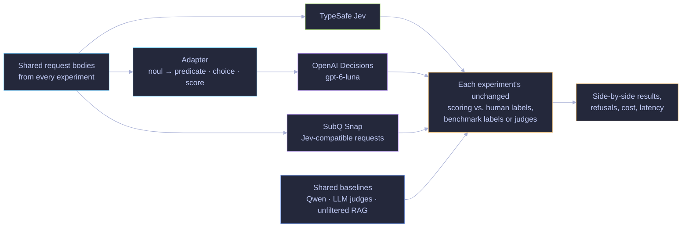

# Decision Model Testing

## Intro

General-purpose decision models such as TypeSafe Jev, OpenAI Decisions and SubQ Snap work like fuzzy switches or scoring systems driven by natural-language prompts. That is a significant part of how LLMs are used in knowledge and context engineering, often at much greater cost.

The research questions are empirical: how well do these models work, where are they already useful, and on which tasks can they replace larger language models?

These experiments test those questions on material that can be described and reproduced publicly. Source data and receipts with redistribution restrictions stay outside this repository.

## Get to it already.

This repo contains experiments comparing general-purpose decision models with LLMs, NLP models and specialized decision models such as rerankers.

I'm not packing all the data into this public repo due to licensing questions, but my goal is to make reproduction straightforward.  The datasets are all freely available and I've included links to them where possible.

Each experiment is a self-contained subfolder of `experiments/`. Provider arms share the same samples, prompts, scoring, and baselines wherever their interfaces permit a direct comparison.

| Experiment | Research question | Status |
|---|---|---|
| [Decision models vs. LLM judges for evals](experiments/jev-vs-LLM-for-evals/README.md) | Can a decision model replace or front an LLM judge on standard judging benchmarks? | Complete |
| [Search-result filtering before Kimi K3](experiments/jev-search-result-narrower/README.md) | Does filtering retrieved chunks with a decision model cut RAG answering cost without hurting answers? | Complete |
| [Search-result filtering before Claude](experiments/jev-search-result-narrower-claude-RAG/README.md) | Do probability and categorical filtering hold up before a stronger answering model? | Complete |
| [Decision models vs. rerankers](experiments/jev-vs-rerankers/README.md) | How well does a decision model order passages against human relevance judgments, compared with a dedicated reranker? | Complete |
| [Request shaping for decision models](experiments/request-shaping/README.md) | Should you pack items into one state, ask many questions per request, and where should evidence sit? | Complete |
| [Easy deterministic controls](experiments/easy-decisions/README.md) | Do trivial exact choices, lookups, and arithmetic judgments survive independent ordering changes? | Complete |
| [Graded intent routing](experiments/intent-difficulty-ladder/README.md) | How do accuracy and ordering stability change as intent menus grow? | Complete |
| [OpenAI Decisions adapter](experiments/openai-decisions-adapter/README.md) | How do Jev requests translate to OpenAI Decisions? (shared code, not a study) | Released |
| [SubQ Snap adapter](experiments/subq-adapter/README.md) | How are Jev-compatible requests validated, sent, and recorded for SubQ? (shared code, not a study) | Released |
| [Decision model to narrow web search results](https://github.com/dorkitude/webctl) | Can Jev trim search results, and their content, to the goal of the original query? | Reusable MIT-licensed CLI |

### Synopses

**[Decision models vs. LLM judges for evals](experiments/jev-vs-LLM-for-evals/README.md)** weighs Jev, OpenAI Decisions and SubQ Snap against four open LLM judges (GPT-OSS 120B, DeepSeek V4 Flash, GLM 5p3, Qwen3p8 Max) on LLMBar, JudgeBench and RewardBench 2 through one Go harness. On LLMBar Vanilla / JudgeBench vanilla / RewardBench 2 ratings, strict benchmark-label agreement was 87.36% / 69.03% / 68.12% for Jev, 79.16% / 23.87% / 61.32% for Decisions, 88.06% / 72.10% / 69.39% for SubQ, and 87.05% / 77.10% / 79.56% for GPT-OSS. Decisions picked the first-shown response in both orders on 71% of JudgeBench vanilla pairs and refused 159 RewardBench requests; SubQ did so on 9.2%, with no refusals or failed attempts. Held-out JudgeBench → GPT-OSS cascades scored 80.12% for Jev-first and 78.56% for SubQ-first versus 76.41% for GPT-OSS alone; their respective accounting costs were 0.56× and 0.26× the fallback.

**[Search-result filtering before Kimi K3](experiments/jev-search-result-narrower/README.md)** asks Jev and OpenAI Decisions whether each retrieved EnronQA chunk is useful and passes only chunks with p ≥ 0.5 to Kimi K3, on 100 paired questions. With the common DeepSeek v4p1 judge, 97/100 unfiltered answers, 96/100 Jev-filtered answers, and 94/100 Decisions-filtered answers were accepted (Decisions − Jev −2 points [−5, 0]). Jev kept 307 of 2,020 chunks; Decisions kept 263 and agreed with Jev on 95.6% of chunk decisions (κ 0.82). The estimated whole-pipeline costs were $1.65 for Jev filtering and $1.69 for Decisions filtering, against $5.06 for the original unfiltered configuration.

**[Search-result filtering before Claude](experiments/jev-search-result-narrower-claude-RAG/README.md)** tests the filter before Claude Opus 5 on a disjoint 100-question sample, with a probability threshold and a categorical mode (direct / supporting / irrelevant). Under the common DeepSeek v4p1 judge, Decisions matched Jev within one answer: 94 vs. 95 (threshold) and 94 vs. 94 (categorical), against 94 and 93 unfiltered, while returning fewer chunks (249 vs. 323; 313 vs. 421). Estimated pipeline costs were $5.15 and $5.98 for Decisions, $6.21 and $7.44 for Jev, and $26.91 unfiltered. The Decisions answers used a different Claude subscription route, a stated confound.

**[Decision models vs. rerankers](experiments/jev-vs-rerankers/README.md)** compares Qwen3 Reranker 8B with Jev, OpenAI Decisions and SubQ probability, expected-grade and ordinal scores over the same 100 BM25 candidates for all 97 TREC DL 2019/2020 queries, scored by NIST human judgments. Expected-grade nDCG@10 was 0.6994 for Qwen, 0.6917 for Jev, 0.7006 for Decisions and 0.7206 for SubQ. SubQ's difference was +0.0212 [−0.0006, +0.0419] against Qwen and +0.0289 [+0.0124, +0.0470] against Jev. Its best observed exploratory prompt scored 0.7208; prompt selection used this benchmark and is not held-out validation.

**[Request shaping for decision models](experiments/request-shaping/README.md)** runs three controlled studies on the same TREC passages: packing passages into one state, asking up to 16 questions per request, and moving evidence through 10- or 40-passage states. Jev gains +0.036 nDCG@10 at K = 100 while cutting tokens per decision from 438 to 189. Decisions packing is not significant and does not save tokens; fan-out is exactly invariant, and putting the question before a long state raises AUC from 0.85 to 0.90. SubQ gains +0.015 at K = 10 (Holm p = 0.197), shows a 40-passage start-over-middle AUC advantage of +0.0196, and keeps first-position fan-out changes near zero; its service rejects more than 16 questions, so larger packed-question arms are excluded. Estimated costs are $7.54 for Jev, $19.98 for Decisions, and $7.34 for SubQ.

**[Easy deterministic controls](experiments/easy-decisions/README.md)** cross candidate display, API option, question, and record position on 60 synthetic base cases. Jev and OpenAI Decisions answered all 880 requests correctly. SubQ answered all 560 exact-choice and lookup requests correctly and 312/320 arithmetic requests; its eight misses reproduce under one joint response-position/option-order condition. All three providers agreed on every byte-identical repeat.

**[Graded intent routing](experiments/intent-difficulty-ladder/README.md)** classifies held-out CLINC150 and BANKING77 examples against nested intent menus, then tests identical calls and candidate-order shuffles. SubQ scored 192/200 on CLINC's in-scope/OOS stage, 108/120 at all 77 BANKING intents, 0/270 label changes on identical calls, and 3/300 after shuffling. Its labels are stable, but its gold-option probabilities still move by a mean absolute 0.025–0.049 under shuffling.

**[OpenAI Decisions adapter](experiments/openai-decisions-adapter/README.md)** is the small, dependency-free Go package that translates a Jev request body into a Decisions request (noul → predicate, choice → choice, score → score), sends it, and converts the answers back into Jev's response shape, keeping refusals visible. It gives each provider arm the same request content.

**[SubQ Snap adapter](experiments/subq-adapter/README.md)** is a dependency-free Go client for SubQ's Jev-compatible endpoint. It preserves state, questions, criteria, and ordering, records every intentional edit and both body hashes, validates published limits and the observed 16-question ceiling before sending, and keeps failures and list-price cost accounting explicit.

**[Decision model to narrow web search results](https://github.com/dorkitude/webctl)** uses Jev to filter both web-search results and retrieved page content against the original query. The implementation is maintained as a reusable MIT-licensed CLI.

## Provider comparison

OpenAI's [Decisions API](https://developers.openai.com/api/docs/guides/decisions) (`gpt-6-luna`, public beta), TypeSafe Jev and SubQ Snap answer the same kinds of typed questions. The [OpenAI translation adapter](experiments/openai-decisions-adapter/README.md) and [SubQ client](experiments/subq-adapter/README.md) preserve the shared request content. Samples, prompts, scoring and baselines are held fixed across provider arms wherever the interfaces permit direct comparison.

| Experiment | Measure | Baseline | Jev | Decisions | SubQ |
|---|---|---:|---:|---:|---:|
| Rerankers (expected grade) | nDCG@10 | Qwen 0.6994 | 0.6917 | 0.7006 | **0.7206** |
| LLM judges, LLMBar Vanilla | strict agreement | GPT-OSS 87.05% | 87.36% | 79.16% | **88.06%** |
| LLM judges, JudgeBench vanilla | strict agreement | GPT-OSS 77.10% | 69.03% | 23.87% | **72.10%** |
| LLM judges, RewardBench 2 ratings | strict agreement | GPT-OSS 79.56% | 68.12% | 61.32% | **69.39%** |
| Kimi RAG filter | accepted /100, same judge | 97 | 96 | 94 | — |
| Claude RAG filter, threshold | accepted /100, same judge | 94 | 95 | 94 | — |
| Claude RAG filter, categorical | accepted /100, same judge | 93 | 94 | 94 | — |
| Request shaping | retest mean \|Δp\| | n/a | 0.0094 | 0.0000 | 0.0001–0.0002 |

In short: performance depends strongly on the task and request shape. SubQ produced the strongest relevance-ranking scores in this suite's TREC experiment and outscored Jev on most eval-judging methods, while the open LLM judges remained strongest on several headline judging benchmarks. Decisions was a reasonable relevance scorer and RAG filter but a poor pairwise judge under these prompts because of a strong first-position bias. Each experiment's README reports intervals, failures, costs, latency and caveats beside the other provider results.

This distribution contains code, original prompts, synthetic tests and aggregate measurements. Datasets, source-bearing answers/receipts, archives, private correspondence and prior Git history are excluded.

See [reproduction and limits](REPRODUCTION.md) and [third-party notices](THIRD_PARTY_NOTICES.md).
