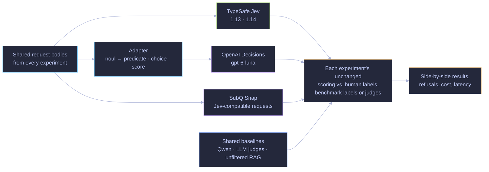

# Decision Model Testing

## Intro

General-purpose decision models such as TypeSafe Jev (versions 1.13 and 1.14), OpenAI Decisions and SubQ Snap work like fuzzy switches or scoring systems driven by natural-language prompts. That is a significant part of how LLMs are used in knowledge and context engineering, often at much greater cost.

The research questions are empirical: how well do these models work, where are they already useful, and on which tasks can they replace larger language models?

These experiments test those questions on material that can be described and reproduced publicly. Source data and receipts with redistribution restrictions stay outside this repository.

## Get to it already.

This repo contains experiments comparing general-purpose decision models with LLMs, NLP models and specialized decision models such as rerankers.

I'm not packing all the data into this public repo due to licensing questions, but my goal is to make reproduction straightforward.  The datasets are all freely available and I've included links to them where possible.

Each experiment is a self-contained subfolder of `experiments/`. Provider arms share the same samples, prompts, scoring, and baselines wherever their interfaces permit a direct comparison.

| Experiment | Research question | Status |
|---|---|---|
| [Decision models vs. LLM judges for evals](experiments/jev-vs-LLM-for-evals/README.md) | Can a decision model replace or front an LLM judge on standard judging benchmarks? | Complete |
| [Search-result filtering before Kimi K3](experiments/jev-search-result-narrower/README.md) | Does filtering retrieved chunks with a decision model cut RAG answering cost without hurting answers? | Complete |
| [Search-result filtering before Claude](experiments/jev-search-result-narrower-claude-RAG/README.md) | Do probability and categorical filtering hold up before a stronger answering model? | Complete |
| [Decision models vs. rerankers](experiments/jev-vs-rerankers/README.md) | How well does a decision model order passages against human relevance judgments, compared with a dedicated reranker? | Complete |
| [Request shaping for decision models](experiments/request-shaping/README.md) | Should you pack items into one state, ask many questions per request, and where should evidence sit? | Complete |
| [Easy deterministic controls](experiments/easy-decisions/README.md) | Do trivial exact choices, lookups, and arithmetic judgments survive independent ordering changes? | Complete |
| [Graded intent routing](experiments/intent-difficulty-ladder/README.md) | How do accuracy and ordering stability change as intent menus grow? | Complete |
| [Order-blind decisions](experiments/order-blind-decisions/README.md) | Do decision models judge responses differently depending on where those responses appear (primacy and recency)? | Complete; separate repository (submodule) |
| [OpenAI Decisions adapter](experiments/openai-decisions-adapter/README.md) | How do Jev requests translate to OpenAI Decisions? (shared code, not a study) | Released |
| [SubQ Snap adapter](experiments/subq-adapter/README.md) | How are Jev-compatible requests validated, sent, and recorded for SubQ? (shared code, not a study) | Released |
| [Decision model to narrow web search results](https://github.com/dorkitude/webctl) | Can Jev trim search results, and their content, to the goal of the original query? | Reusable MIT-licensed CLI |

### Synopses

### [Decision models vs. LLM judges for evals](experiments/jev-vs-LLM-for-evals/README.md)

This experiment compares decision models and open LLM judges on three standard judging benchmarks and selective-routing simulations.

**TL;DR**

No judge dominated every benchmark. Qwen3p8 Max led the three headline LLMBar, JudgeBench, and RewardBench 2 methods at 92.53%, 88.39%, and 81.57% strict agreement. Among decision models, Jev 1.14 led LLMBar at 88.24% and SubQ led JudgeBench and RewardBench 2 at 72.10% and 69.39%, against Jev 1.14's 70.81% and 69.14% and Jev 1.13's 87.36%, 69.03%, and 68.12%. Jev 1.14 scored above Jev 1.13 on all 19 primary methods, by +0.2 to +3.5 points with 1.13's service failures recovered (5 intervals exclude zero, led by JudgeBench arena-hard +3.5), and it completed every request without an invalid job. Decisions was competitive on some LLMBar rating prompts but fell to 23.87% on JudgeBench vanilla because it selected the first-shown response in both presentation orders for 71.1% of pairs. SubQ showed a much smaller 9.2% version of that bias and completed 29,487 requests without failure or refusal, while Decisions refused 159 RewardBench requests. A held-out Jev 1.13-first JudgeBench cascade improved GPT-OSS from 76.41% to 80.12% while reducing accounting cost by 43.69%; the Jev 1.14-first cascade saved 77.43% for a smaller, inconclusive +2.1-point gain, and other cascades were weaker or inconclusive. Scores measure benchmark-label agreement, not independently verified correctness, and reported intervals are not multiplicity-adjusted.

### [Search-result filtering before Kimi K3](experiments/jev-search-result-narrower/README.md)

This experiment measures whether decision-model filtering reduces the context and cost of Kimi K3 RAG answers without reducing answer quality.

**TL;DR**

Filtering cut estimated Kimi pipeline cost by about two-thirds without a clear answer-quality loss on this 100-question sample. Under one common GLM 5p3 Flash judge, SubQ-filtered answers scored highest at 95/100, followed by unfiltered and Jev 1.14-filtered at 94, Jev 1.13-filtered at 93, and Decisions-filtered at 90. None of the paired differences from unfiltered excluded zero: SubQ was +1 point [−3, +5], Jev 1.14 +0 [−5, +5], Jev 1.13 −1 [−7, +5], and Decisions −4 [−11, +2]; a second GLM pass moved arms by up to 3 points, which is larger than the gap between the two Jev versions. Jev 1.13 retained 307 of 2,020 chunks, Jev 1.14 283 of 2,000, SubQ 267, and Decisions 263 of 2,040; Jev 1.14 agreed with Jev 1.13 on 98.25% of identical keep/drop decisions, and SubQ and Decisions agreed with Jev 1.13 on 96.0% and 95.6%. Estimated whole-pipeline costs were $1.60–$1.69 for filtered arms versus $5.06 unfiltered. GLM is a model judge rather than human ground truth, and all judgments used its supported low-reasoning mode, so these results support cost reduction more strongly than any provider ranking.

### [Search-result filtering before Claude](experiments/jev-search-result-narrower-claude-RAG/README.md)

This experiment tests probability-threshold and categorical decision-model filters before Claude Opus 5 on a disjoint RAG sample.

**TL;DR**

All four decision-model filters reduced the context sent to Claude, and the common GLM 5p3 Flash judge favored the filtered answers on this 100-question sample. In threshold mode, GLM accepted 80 unfiltered answers, 87 Jev 1.13-filtered, 87 Jev 1.14-filtered, 89 Decisions-filtered, and 92 SubQ-filtered; Decisions and SubQ improved on baseline by +9 points [+2, +16] and +12 [+5, +19], while Jev's +7 interval touched zero [0, +14]. In categorical mode, the scores were 80, 81, 91, 89, and 90, with Decisions +9 [+3, +15] and SubQ +10 [+3, +18]. SubQ retained 264 threshold chunks and 292 categorical chunks, compared with Jev's 322 and 420. These answer differences do not isolate the filter: baseline and Jev 1.13 answers used Claude Code Max, whereas Jev 1.14, Decisions and SubQ used Team. With both Jev versions answered on Team and judged in one pass, Jev 1.14 − Jev 1.13 was −3 points [−8, +1] in threshold mode and +6 [+1, +12] in categorical mode, near the run-to-run noise of Claude and the judge. GLM is also a model judge, not human ground truth, and used its supported low-reasoning mode. The results support substantial context reduction, but provider rankings remain confounded by route and sample.

### [Decision models vs. rerankers](experiments/jev-vs-rerankers/README.md)

This experiment compares three general-purpose decision models with Qwen3 Reranker 8B on human-judged TREC passage ranking.

**TL;DR**

SubQ produced the best relevance ranking in this 97-query TREC DL comparison: its expected-grade score reached 0.7206 nDCG@10, ahead of Decisions at 0.7006, Qwen3 Reranker 8B at 0.6994, Jev 1.13 at 0.6917, and Jev 1.14 at 0.6896. The two Jev versions were within noise of each other on every one of the 12 Jev arms (mean change +0.0017 nDCG@10). Against Jev 1.13, SubQ's expected-grade gain was +0.0289 with a 95% interval of [+0.0124, +0.0470]; its +0.0212 interval against Qwen narrowly included zero. Expected grade was the strongest frozen scoring formulation for every decision-model provider, while probability was weakest. Decisions roughly matched Qwen and Jev on the primary arms, and 23 refusals hurt one exploratory ordinal prompt. SubQ also had the lowest estimated list cost for its three primary arms, at $0.46 total versus $0.62 for each Jev version, $1.28 for Decisions, and $0.33 for Qwen. SubQ's was the lowest among the decision models. The benchmark is small, public, and potentially present in model training; prompt variants were inspected on the same queries, so the exploratory best-prompt results are not held-out validation.

### [Request shaping for decision models](experiments/request-shaping/README.md)

This experiment tests state packing, question fan-out, and evidence position on human-judged TREC passage relevance.

**TL;DR**

Request shape changed model behavior, but the useful pattern depended on the provider. Packing 100 passages raised Jev 1.13 nDCG@10 by +0.036 and Jev 1.14 by +0.032 (+0.034 at 50 passages), and cut input tokens per decision from 438 to 189 for both; Decisions gained only +0.015 with no token saving, while SubQ gained +0.015 at 10 passages but could not run larger packed-question arms because of a 16-question service limit. Co-asked questions were effectively independent when the target came first: mean probability changes matched each Jev version's own retest noise (0.009 for Jev 1.13, 0.012 for Jev 1.14) and were zero for Decisions and about 0.0001 for SubQ. SubQ's target moved about 0.013 when placed last among 16 questions. Long states showed no general “lost in the middle” effect; both Jev versions scored a needle at the end of a 40-passage state slightly worse (−0.009 AUC), and SubQ favored the start of a 40-passage state by +0.0196 AUC over the middle; putting the question before the state helped Decisions most. Practical guidance is therefore provider-specific: use named references, freeze layout and ordering, validate packing empirically, and do not treat multi-question independence as position independence.

### [Easy deterministic controls](experiments/easy-decisions/README.md)

This experiment crosses display and API ordering on exact-choice, lookup, and arithmetic controls with objectively correct answers.

**TL;DR**

Jev 1.13, Jev 1.14, and OpenAI Decisions were perfectly accurate across all 880 exact-choice, lookup, and arithmetic requests, while SubQ was perfect on the 560 exact-choice and lookup requests but scored 312/320 on arithmetic. SubQ's eight misses were not random: two arithmetic cases failed reproducibly only when the correct response appeared second and the API choice options were reversed. All four models returned identical labels on every byte-identical repeat, so the main distinction is ordering robustness rather than ordinary run-to-run instability. SubQ used the fewest reported input tokens but had higher observed round-trip latency; differing provider routes and loads make that latency comparison descriptive only. These deliberately easy synthetic controls do not establish general task accuracy, but they show that crossing display order with API option order can reveal systematic failures that aggregate accuracy or simple repetition would miss.

### [Graded intent routing](experiments/intent-difficulty-ladder/README.md)

This experiment measures classification accuracy and ordering stability as held-out CLINC150 and BANKING77 intent menus grow.

**TL;DR**

The four decision models were more accurate and substantially more label-stable than Haiku 5.5 on these held-out intent-routing samples. On CLINC's 30-intent plus out-of-scope task, Jev 1.14 scored 194/200 and Jev 1.13, Decisions, and SubQ each scored 192/200, versus 112/200 for Haiku. At all 77 BANKING intents, Decisions led with 110/120, while both Jev versions and SubQ scored 108/120 and Haiku scored 90/120. Candidate shuffling changed 116/298 Haiku labels, compared with 8/299 for Jev 1.13, 9/300 for Jev 1.14, 5/299 for Decisions, and 3/300 for SubQ; byte-identical repeats changed 51/270 Haiku labels, 1/269 for Jev 1.13, 4/270 for Jev 1.14 (all on one case), and none for Decisions or SubQ. SubQ's labels were the most stable, yet its gold-option probabilities still moved by mean absolute 0.025–0.049 when candidates were reordered. The samples contain only 30 independent examples per menu width, so small provider differences are descriptive, and the non-monotonic results do not support a universal menu-size cutoff.

### [Order-blind decisions](experiments/order-blind-decisions/README.md)

This experiment rotates the four RewardBench 2 responses for all 1,865 prompts through every position (76,200 requests per model) to test whether decision models favor the first or last response. It lives in its own repository, [`dorkitude/order-blind-decisions`](https://github.com/dorkitude/order-blind-decisions), included here as a Git submodule.

**TL;DR**

Both Jev versions were order-blind on the preregistered ±3 pp test. Moving the correct answer to the first or last slot changed Jev 1.13's pick rate by +0.2 pp and Jev 1.14's by −1.7 and −0.5 pp, and they were the most accurate judges at 80.9% and 81.3%. OpenAI Decisions (+6.1 pp when first) and SubQ Snap (+7.0 pp when first) showed primacy, Microsoft-Decision-1 showed a −4.5 pp penalty when last, and Cloudflare Clef-flash was inconclusive at 62.7% accuracy. On exact ties, every model except Microsoft-Decision-1 usually picked the response shown first, Jev 1.14 less often (64.0%) than Jev 1.13 (71.5%).

### Shared components

The **[OpenAI Decisions adapter](experiments/openai-decisions-adapter/README.md)** translates Jev requests into Decisions requests and converts answers back without hiding refusals. The **[SubQ Snap adapter](experiments/subq-adapter/README.md)** validates and records Jev-compatible SubQ requests, published limits, body hashes, failures, and list-price cost accounting.

**[Decision model to narrow web search results](https://github.com/dorkitude/webctl)** uses Jev to filter both web-search results and retrieved page content against the original query. The implementation is maintained as a reusable MIT-licensed CLI.

## Provider comparison

OpenAI's [Decisions API](https://developers.openai.com/api/docs/guides/decisions) (`gpt-6-luna`, public beta), TypeSafe Jev (`jev-1.13.0` and `jev-1.14.0`) and SubQ Snap answer the same kinds of typed questions. The [OpenAI translation adapter](experiments/openai-decisions-adapter/README.md) and [SubQ client](experiments/subq-adapter/README.md) preserve the shared request content. Samples, prompts, scoring and baselines are held fixed across provider arms wherever the interfaces permit direct comparison.

| Experiment | Measure | Baseline | Jev 1.13 | Jev 1.14 | Decisions | SubQ |
|---|---|---:|---:|---:|---:|---:|
| Rerankers (expected grade) | nDCG@10 | Qwen 0.6994 | 0.6917 | 0.6896 | 0.7006 | **0.7206** |
| LLM judges, LLMBar Vanilla | strict agreement | GPT-OSS 87.05% | 87.36% | **88.24%** | 79.16% | 88.06% |
| LLM judges, JudgeBench vanilla | strict agreement | GPT-OSS 77.10% | 69.03% | 70.81% | 23.87% | **72.10%** |
| LLM judges, RewardBench 2 ratings | strict agreement | GPT-OSS 79.56% | 68.12% | 69.14% | 61.32% | **69.39%** |
| Kimi RAG filter | accepted /100, common GLM judge | 94 | 93 | 94 | 90 | **95** |
| Claude RAG filter, threshold | accepted /100, common GLM judge | 80 | 87 | 87 | 89 | **92** |
| Claude RAG filter, categorical | accepted /100, common GLM judge | 80 | 81 | 91 | 89 | **90** |
| Request shaping | retest mean \|Δp\| | n/a | 0.0094 | 0.0122–0.0127 | 0.0000 | 0.0001–0.0002 |

In short: performance depends strongly on the task and request shape. The two Jev versions behave alike: Jev 1.14 is level with Jev 1.13 on ranking, RAG filtering, intent routing and easy controls, scores higher on every LLM-judging method (+0.2 to +3.5 points), stays order-blind on the primacy/recency study, and has slightly higher run-to-run noise, at the same token cost. SubQ produced the strongest relevance-ranking scores in this suite's TREC experiment, outscored Jev on most eval-judging methods, and had the highest GLM-judged RAG answer score in all three comparisons. Decisions was a reasonable relevance scorer and RAG filter but a poor pairwise judge under these prompts because of a strong first-position bias. Claude route differences confound its RAG filter comparison, and model-judge scores are not human ground truth. Each experiment's README reports intervals, failures, costs, latency, and caveats beside the other provider results.

This distribution contains code, original prompts, synthetic tests and aggregate measurements. Datasets, source-bearing answers/receipts, archives, private correspondence and prior Git history are excluded.

See [reproduction and limits](REPRODUCTION.md) and [third-party notices](THIRD_PARTY_NOTICES.md).
