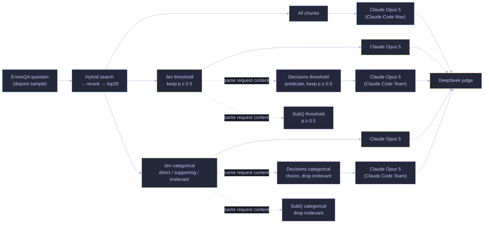
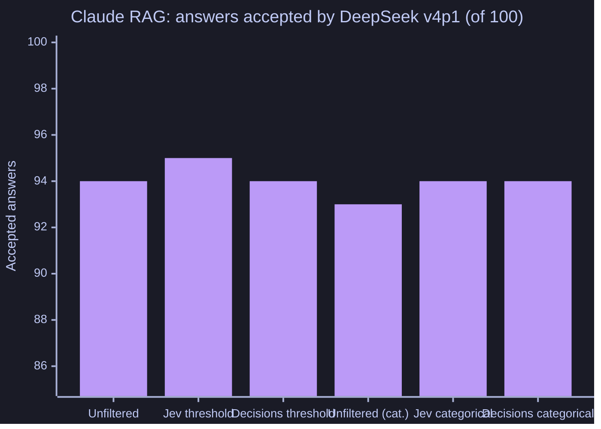

# Claude RAG filtering

Jev, OpenAI Decisions and SubQ Snap filter top20 reranked search results for Claude Opus 5. The baseline gets all chunks; treatments keep probability ≥0.5 or categories `direct_evidence` and `supporting_evidence` (discard `irrelevant`). Categorical mode uses no numerical cutoff. Whole chunks are paged under 6,000 proxy tokens, 24,000 bytes and six decisions.

| Pipeline | DeepSeek accepted /100 | Estimated model cost | Mean time to final answer |
|---|---:|---:|---:|
| Unfiltered | 96 | $26.91 | 5.93 s |
| Jev threshold | 95 | $6.21 | 4.89 s |
| Jev categorical | 96 | $7.44 | 5.38 s |

Costs cover answering, filtering, embedding and reranking; exclude judging, indexing and infrastructure. Claude costs are API-equivalent estimates, not incremental Max charges. Timing begins at the first Claude invocation and includes CLI startup and intervening searches; it excludes initial retrieval/filtering and grading. The categorical comparison uses the same saved controls on an inspected sample; outcomes do not establish superiority. Two question workers were used. The sample differs from Kimi's, so this is not a controlled model comparison.

## How it works

All arms share retrieval. The threshold arm keeps chunks by probability; the categorical arm discards only `irrelevant` and has no numerical cutoff. Each decision-model provider receives the same filter-request content. The SubQ branches are filter-only comparisons and do not generate Claude answers.

## Provider comparison

The filter is the only intended pipeline difference by decision-model provider. The [OpenAI adapter](../openai-decisions-adapter/README.md) maps threshold-mode Noul questions to predicates and categorical-mode questions to three-option choices, while the [SubQ adapter](../subq-adapter/README.md) sends the Jev-compatible requests directly. The 100 questions, cached searches, paging guards, Claude model and prompts, and judge prompt are shared.

**Two comparison caveats.** (1) *Claude route:* the Decisions-filtered arms used Claude Code on a Team subscription; the Jev and unfiltered arms used Claude Code Max. The model and prompts are the same, but route effects are confounded with filter effects. (2) *Judge:* `deepseek-v4p1-flash` judges every answer arm with the same prompt and request shape; the frozen `deepseek-v4-flash-0731` model is no longer hosted. Only same-judge numbers are compared below. On the 400 answers scored by both judge versions, they agreed 198 of 200 times in threshold mode (κ 0.89) and 195 of 200 in categorical mode (κ 0.75); every disagreement was accepted by v4 Flash and rejected by v4p1.

| Pipeline | DeepSeek v4p1 accepted /100 | Chunks returned to Claude | Estimated model cost |
|---|---:|---:|---:|
| Unfiltered | 94 | all | $26.91 |
| Jev threshold | 95 | 323 | $6.21 |
| **Decisions threshold** | **94** | 249 | $5.15 |
| Unfiltered (categorical-mode re-judge) | 93 | all | $26.91 |
| Jev categorical | 94 | 421 | $7.44 |
| **Decisions categorical** | **94** | 313 | $5.98 |

The unfiltered answers are identical in both modes; each mode's re-judge judged them separately, and the v4p1 judge changed its verdict on 1 of the 100 (94 vs. 93). That is the scale of judge noise against which the one-point differences below should be read.

Paired differences under the same judge (cluster bootstrap by source document, 95%, descriptive): threshold mode, Decisions minus Jev −1 point [−3, 0] (Jev alone correct on 1 question) and Decisions minus unfiltered 0 [0, 0]; categorical mode, Decisions minus Jev 0 [−3, +3] (one question each way) and Decisions minus unfiltered +1 [−2, +5].

SubQ's filter-only comparisons use the identical frozen chunks:

| Mode | Jev kept | Decisions kept | SubQ kept | Decisions/Jev agreement | SubQ/Jev agreement | SubQ cost |
|---|---:|---:|---:|---:|---:|---:|
| Threshold | 322 | 249 | 264 | 94.7% | **95.9%** | $0.0887 |
| Categorical | 420 | 311 | 292 | **92.3%** | 91.9% | $0.0992 |

All 823 SubQ filter requests succeeded on the first attempt. Median round trips were 0.308 s in threshold mode and 0.270 s in categorical mode. No Claude answers were generated for these arms, so the table does not imply downstream answer quality.

**Filter agreement.** On 2,000 byte-identical chunk decisions, threshold mode agreed with Jev on 94.7% of keep/drop decisions (κ 0.78; probability correlation 0.91), keeping 249 vs. 322; categorical mode agreed on 92.3% (κ 0.74), keeping 311 vs. 420. In categorical mode Decisions moved most of Jev's `supporting_evidence` chunks to `irrelevant` (112 of 169). Source-document coverage of the initial search was 97 before and 96 of 100 after filtering in both modes.

**Decisions as the answer judge.** Under the [Jev rescore](results/jev-rescore-v1/summary.json) protocol on the same 200 answers, Decisions accepted 89 unfiltered and 86 Jev-filtered answers. It agreed with the frozen DeepSeek verdicts on 184 of 200 (κ 0.50; all 16 disagreements were answers DeepSeek accepted and Decisions rejected), where Jev agreed on 178 of 200. It agreed with Jev's rescoring on 176 of 200 (κ 0.50). The 200 requests had 0 refusals and cost $0.021.

**SubQ as the answer judge.** On the same 200 saved answers, SubQ accepted 93 unfiltered and 90 Jev-filtered answers. It agreed with DeepSeek on 192/200 judgments (κ 0.67) and with Jev's rescoring on 182/200 (κ 0.58). All requests succeeded on the first attempt and cost $0.0107.

**Refusals: 0** for Decisions and SubQ in filtering and rescoring. No SubQ request failed or retried.

**Cost and latency.** The Decisions filter cost $0.19 (threshold, 415 pages) and $0.20 (categorical, 424 pages) at $0.10 per million input tokens. Because it returned fewer chunks, Claude read less: the whole Decisions-filtered pipeline came to $5.15 and $5.98 against $6.21 and $7.44 with the Jev filters and $26.91 unfiltered. Claude costs are API-equivalent list estimates, not subscription charges. The answer stage (filtering, Claude and follow-up searches) took a median 3.1 s and 3.3 s against 5.1 s and 5.2 s for the Jev arms, but on a different Claude route and under different service conditions, so that difference is not attributable to the filter.

**Caveats.** 100 questions per mode; DeepSeek, Jev and SubQ verdicts are model assessments, not human truth; the filter prompts were written for Jev; the Claude route changed. The SubQ filter-only arms measure agreement and resources, not downstream answer accuracy. Source-free aggregates: [Decisions](results/openai-decisions-v1/README.md) · [SubQ](results/subq-v1/README.md).

## Reproduce

See [shared setup and limits](../../REPRODUCTION.md). From this directory, build with `go build ./...`, run synthetic checks with `go test ./...`, and inspect CLI help before any paid run. Numerical reports are under `results/`. No original receipt archive is required or available in this distribution.
