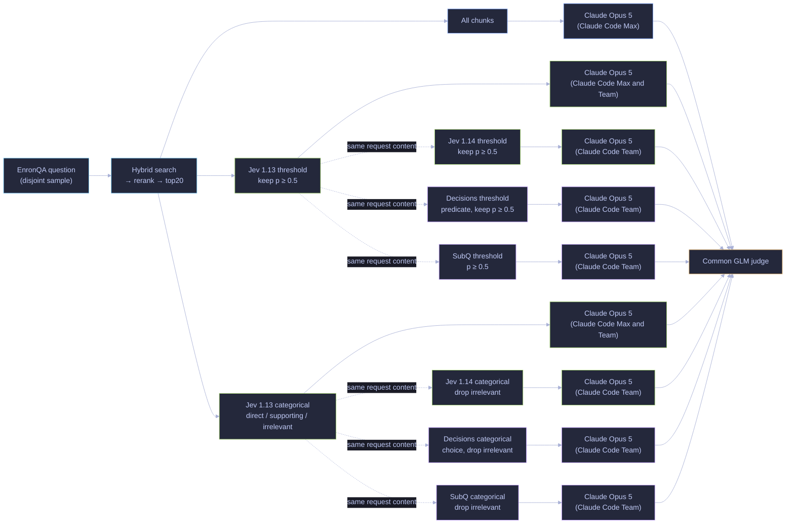
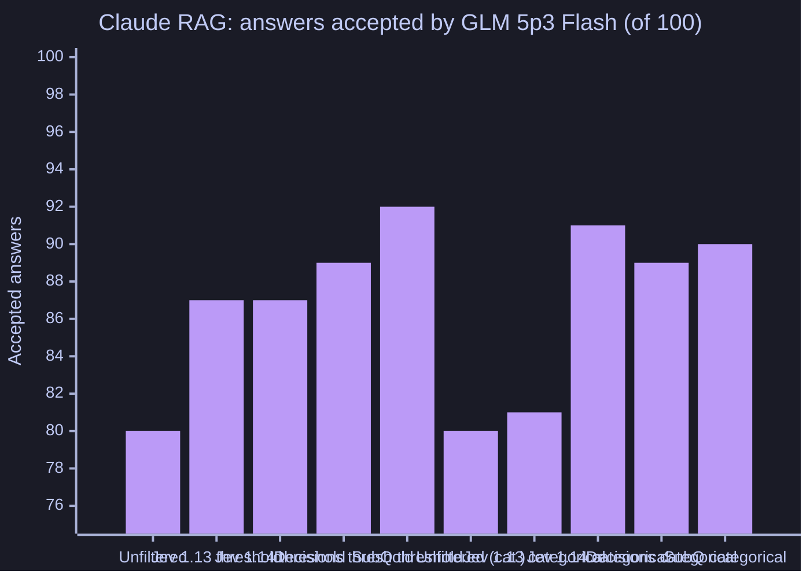

# Claude RAG filtering

## TL;DR

Under the shared DeepSeek v4p1 judge, Rune-filtered Claude answers scored 93/100 in probability mode and 92/100 in categorical mode, versus Jev 1.13’s 95 and 94. Both Rune − Jev gaps were −2 pp [−5, 0], within judge noise. Claude’s Rune arm used the Team route while those Jev and unfiltered arms used Max, so route and filter effects are confounded.

All four decision-model filters reduced the context sent to Claude, and the common GLM 5p3 Flash judge favored the filtered answers on this 100-question sample. In threshold mode, GLM accepted 80 unfiltered answers, 87 Jev 1.13-filtered, 87 Jev 1.14-filtered, 89 Decisions-filtered, and 92 SubQ-filtered; Decisions and SubQ improved on baseline by +9 points [+2, +16] and +12 [+5, +19], while both Jev versions' +7 intervals touched zero. In categorical mode, the scores were 80, 81, 91, 89, and 90, with Jev 1.14 +11 [+4, +18], Decisions +9 [+3, +15] and SubQ +10 [+3, +18]. These answer differences do not isolate the filter: baseline and Jev 1.13 answers used Claude Code Max, whereas Jev 1.14, Decisions and SubQ used Team, and Jev 1.13's own filter decisions scored 3 and 6 points higher when answered on Team. With both Jev versions answered on Team and scored in one GLM pass, Jev 1.14 − Jev 1.13 was −3 points [−8, +1] in threshold mode and +6 [+1, +12] in categorical mode, against a noise floor of about ±3 points from Claude's answer variation and judge repeatability. SubQ retained 264 threshold chunks and 292 categorical chunks and Jev 1.14 retained 308 and 378, compared with Jev 1.13's 322 and 420. GLM is also a model judge, not human ground truth, and used its supported low-reasoning mode. The results support substantial context reduction, but provider rankings remain confounded by route and sample.

Jev 1.13, Jev 1.14, OpenAI Decisions and SubQ Snap filter top20 reranked search results for Claude Opus 5. The baseline gets all chunks; treatments keep probability ≥0.5 or categories `direct_evidence` and `supporting_evidence` (discard `irrelevant`). Categorical mode uses no numerical cutoff. Whole chunks are paged under 6,000 proxy tokens, 24,000 bytes and six decisions. Jev 1.14 was called by its pinned model id `jev-1.14.0`, because the `jev-latest` alias still resolved to `jev-1.13.0` when its filters were collected.

Under a common GLM 5p3 Flash judge, threshold filtering scored 87/100 for Jev 1.13, 87/100 for Jev 1.14, 89/100 for Decisions, and 92/100 for SubQ, against 80/100 unfiltered. Categorical filtering scored 81, 91, 89, and 90, against 80 unfiltered. Baseline and Jev 1.13 answers used Claude Code Max, while Jev 1.14, Decisions and SubQ answers used Team, so route effects are confounded with filter effects. The two Jev versions are also compared on a single route, where Jev 1.14 scored −3 points in threshold mode and +6 in categorical mode ([details](#jev-113-and-jev-114-on-the-same-route)). The sample differs from Kimi's and does not support a controlled comparison between answer models.

## How it works

All arms share retrieval. The threshold arm keeps chunks by probability; the categorical arm discards only `irrelevant` and has no numerical cutoff. Each decision-model provider receives the same filter-request content, and every filter has a corresponding Claude answer arm. Jev 1.13's filter decisions were answered on both Claude Code routes, so the two Jev versions can be compared on Team alone.

## Provider comparison

The filter is the only intended pipeline difference by decision-model provider. The [OpenAI adapter](../openai-decisions-adapter/README.md) maps threshold-mode Noul questions to predicates and categorical-mode questions to three-option choices, while the [SubQ adapter](../subq-adapter/README.md) sends the Jev-compatible requests directly. Jev 1.14 receives the Jev 1.13 requests with only the model id changed. The 100 questions, cached searches, paging guards, Claude model and prompts, and judge prompt are shared. Claude's two follow-up searches per mode are issued during answering, so their results can differ between arms.

**Three comparison caveats.** (1) *Claude route:* the Jev 1.14-, Decisions- and SubQ-filtered arms used Claude Code on a Team subscription; the Jev 1.13 and unfiltered arms used Claude Code Max. The model and prompts are the same, but route effects are confounded with filter effects. Jev 1.13's own filter decisions scored 90 (threshold) and 87 (categorical) when answered on Team, against 87 and 81 on Max (+3 points [−2, +8] and +6 [−1, +13]). Team-route answers were also about 20% shorter. (2) *Judge:* GLM 5p3 Flash is thinking-only, so every GLM judgment uses its supported low reasoning effort rather than the rejected `none` setting. State, prompt, temperature, strict JSON schema, and max-token cap are otherwise shared. (3) *Noise floor:* Claude Code exposes no temperature control, so Claude's answers vary between runs even on identical evidence, and two GLM passes over the same Jev 1.14 answers agreed on 96 and 98 of 100 verdicts. Differences of about ±3 points are within this noise.

Source-free aggregates contain scores, paired intervals, judge agreement, and usage for [threshold mode](results/glm-5p3-threshold-common-judge-v1/rejudge-comparison.jsonl) and [categorical mode](results/glm-5p3-categorical-common-judge-v1/rejudge-comparison.jsonl). The Jev 1.14 numbers are in [their own aggregate](results/jev-1.14.0-v1/README.md).

| Mode | Unfiltered | Jev 1.13 filter | Jev 1.14 filter | Decisions filter | SubQ filter |
|---|---:|---:|---:|---:|---:|
| Claude Code route | Max | Max | Team | Team | Team |
| Threshold, GLM accepted /100 | 80 | 87 | 87 | 89 | **92** |
| Categorical, GLM accepted /100 | 80 | 81 | **91** | 89 | 90 |

Jev 1.14's answers were scored in two GLM passes under the same protocol. This table uses the pass paired with the unfiltered verdicts (87 and 91). The [same-route comparison](#jev-113-and-jev-114-on-the-same-route) uses the pass shared with Jev 1.13's Team-route answers, which gave 87 and 93.

Paired differences from unfiltered under the common judge (cluster bootstrap by source document, 95%, descriptive) were, in threshold mode, Jev 1.13 +7 points [0, +14], Jev 1.14 +7 [0, +15], Decisions +9 [+2, +16], and SubQ +12 [+5, +19]. In categorical mode they were Jev 1.13 +1 [−7, +8], Jev 1.14 +11 [+4, +18], Decisions +9 [+3, +15], and SubQ +10 [+3, +18]. Every arm except Jev 1.13 was answered on Team, so these gaps include the route effect described above.

### Jev 1.13 and Jev 1.14 on the same route

Both Jev versions' filter decisions were answered by Claude Opus 5 through Claude Code Team, with the same prompts. One GLM 5p3 Flash pass per mode scored both versions' answers together. This is the like-for-like comparison of the two versions. The provider table instead sets Jev 1.14's Team answers against Jev 1.13's Max answers, which gives 0 points [−5, +6] in threshold mode and +10 [+2, +18] in categorical mode. Those figures mix filter and route effects.

| Mode, Claude Code Team | Judge | Jev 1.13 | Jev 1.14 | Jev 1.14 − Jev 1.13 | Only Jev 1.14 correct / only Jev 1.13 correct |
|---|---|---:|---:|---:|---:|
| Threshold | GLM 5p3 Flash, one shared pass | 90 | 87 | **−3 points [−8, +1]** | 1 / 4 |
| Categorical | GLM 5p3 Flash, one shared pass | 87 | 93 | **+6 [+1, +12]** | 7 / 1 |
| Threshold | DeepSeek v4p1 Flash (secondary) | 94 | 94 | 0 [0, 0] | 0 / 0 |
| Categorical | DeepSeek v4p1 Flash (secondary) | 95 | 94 | −1 [−3, 0] | 0 / 1 |

The unfiltered reference is the Claude Code Max answer set (80/100 under GLM in both modes). No unfiltered answers were scored on Team.

**Noise floor.** Some questions had exactly the same chunks kept by both versions: 74 in threshold mode and 66 in categorical mode. On those questions Claude saw identical evidence, yet only 5 and 2 of its answers were byte-identical. GLM's count of correct answers on them still moved by −2 (67 → 65) and +3 (61 → 64). Differences of about ±3 points are therefore within answer and judge noise. The threshold −3 is inside that range. The categorical +6 has an interval that excludes zero, but 3 of its 6 net questions come from identical evidence. On the 34 categorical questions whose kept set changed, Jev 1.14 led by 3 net questions (26 → 29 correct). DeepSeek v4p1 Flash, a more lenient judge, found no difference in either mode.

### Filtering

The filter-agreement comparison uses identical frozen chunks:

| Mode | Jev 1.13 kept | Jev 1.14 kept | Decisions kept | SubQ kept | Jev 1.14/Jev 1.13 agreement | Decisions/Jev 1.13 agreement | SubQ/Jev 1.13 agreement | SubQ cost |
|---|---:|---:|---:|---:|---:|---:|---:|---:|
| Threshold | 322 | 308 | 249 | 264 | **98.4%** | 94.7% | 95.9% | $0.0887 |
| Categorical | 420 | 378 | 311 | 292 | **97.1%** | 92.3% | 91.9% | $0.0992 |

All 823 SubQ filter requests succeeded on the first attempt. Median round trips were 0.308 s in threshold mode and 0.270 s in categorical mode. All 839 Jev 1.14 filter pages returned HTTP 200 on the first attempt, and every response reported model `jev-1.14.0`. Their median round trips were 0.091 s and 0.093 s, against 0.141 s and 0.140 s for Jev 1.13. The two versions were measured under different service conditions, so these timings are descriptive.

**Filter agreement.** On 2,000 byte-identical chunk decisions, Decisions' threshold mode agreed with Jev 1.13 on 94.7% of keep/drop decisions (κ 0.78; probability correlation 0.91), keeping 249 vs. 322; categorical mode agreed on 92.3% (κ 0.74), keeping 311 vs. 420. In categorical mode Decisions moved most of Jev 1.13's `supporting_evidence` chunks to `irrelevant` (112 of 169). Source-document coverage of the initial search was 97 before and 96 of 100 after Decisions filtering in both modes. Jev 1.14 agreed with Jev 1.13 on 98.4% of threshold decisions (κ 0.94; probability correlation 0.99) and 97.1% of categorical decisions (κ 0.91). It kept slightly fewer chunks; in categorical mode it moved 46 of Jev 1.13's 169 `supporting_evidence` chunks to `irrelevant`. Initial-search source coverage stayed at 97 of 100 after Jev 1.14 filtering.

### Answer judges, cost and latency

**Decisions as the answer judge.** Under the [Jev rescore](results/jev-rescore-v1/summary.json) protocol on the same 200 answers, Decisions accepted 89 unfiltered and 86 Jev 1.13-filtered answers. It agreed with the frozen DeepSeek verdicts on 184 of 200 (κ 0.50; all 16 disagreements were answers DeepSeek accepted and Decisions rejected), where Jev 1.13 agreed on 178 of 200. It agreed with Jev 1.13's rescoring on 176 of 200 (κ 0.50). The 200 requests had 0 refusals and cost $0.021.

**SubQ as the answer judge.** On the same 200 saved answers, SubQ accepted 93 unfiltered and 90 Jev 1.13-filtered answers. It agreed with DeepSeek on 192/200 judgments (κ 0.67) and with Jev 1.13's rescoring on 182/200 (κ 0.58). All requests succeeded on the first attempt and cost $0.0107.

**Refusals: 0** for Decisions and SubQ in filtering and rescoring. No SubQ or Jev 1.14 request failed or retried.

**Cost and latency.** The Decisions filter cost $0.19 (threshold, 415 pages) and $0.20 (categorical, 424 pages) at $0.10 per million input tokens. Because it returned fewer chunks, Claude read less: the whole Decisions-filtered pipeline came to $5.15 and $5.98 against $6.21 and $7.44 with the Jev 1.13 filters on Max and $26.91 unfiltered. The Jev 1.14 filters cost $0.076 and $0.090 at $0.042 per million input tokens, the same as Jev 1.13. Its whole pipeline came to $5.98 and $6.89. On the same Team route, Jev 1.13's filter decisions came to $6.03 and $7.23. So Jev 1.14's smaller categorical keep set saved 6.3% of Claude input tokens on one route (639,764 vs. 682,726), and threshold mode was flat. Shorter Team-route answers lower Claude cost regardless of the filter. Claude costs are API-equivalent list estimates, not subscription charges. The Decisions answer stage (filtering, Claude and follow-up searches) took a median 3.1 s and 3.3 s against 5.1 s and 5.2 s for the Jev 1.13 Max arms, but on a different Claude route and under different service conditions, so that difference is not attributable to the filter. On Team, Claude's median time to answer was about 3.1 s with either Jev version in both modes.

**Caveats.** There are 100 questions per mode. GLM, DeepSeek, Jev, Decisions, and SubQ verdicts are model assessments, not human truth. The filter prompts were written for Jev, and the Claude route differs between arms. Claude's answers and the GLM judge vary enough between runs that differences of about ±3 points are noise. Source-free aggregates: [Decisions](results/openai-decisions-v1/README.md) · [SubQ](results/subq-v1/README.md) · [Jev 1.14](results/jev-1.14.0-v1/README.md).

### Answer quality under DeepSeek v4p1

| Mode | Unfiltered /100 | Jev 1.13 /100 | Rune /100 | Rune pipeline estimate |
|---|---:|---:|---:|---:|
| Probability | 94 | 95 | 93 | $6.44 |
| Categorical | 93 | 94 | 92 | $7.31 |

Each mode uses 100 questions and the same planned retrieval/filter inputs through the [Fireworks client](../fireworks-systemone-adapter/README.md). The shared v4p1 judge replaces retired 0731 for every arm in this panel; these scores are separate from the GLM panel. [Aggregates and source-document bootstrap contrasts](results/rune-v1/summary.json) use 5,000 resamples, seed 20260918. Scores are model judgments, with approximately one verdict per 100 changing on repeated v4p1 judging. The Team-versus-Max route difference prevents attributing the two-question gap solely to the filter. Probability mode delivered 357 chunks and 603,736 Claude input tokens, versus Jev’s 323 and 542,162; Rune’s filter cost was $0.087 at $0.042/M input. Pipeline costs are API-equivalent estimates, excluding judging and index setup; subscription-covered Claude calls were not API invoices.

As a judge of the 200 probability-arm Claude answers, Rune accepted 96/100 in each arm and agreed with the original DeepSeek judge on 199/200 (κ 0.94); Jev accepted 85/100 and 84/100. This is agreement on a small answer set, not independent human validation.

## Reproduce

See [shared setup and limits](../../REPRODUCTION.md). From this directory, build with `go build ./...`, run synthetic checks with `go test ./...`, and inspect CLI help before any paid run. Numerical reports are under `results/`. No original receipt archive is required or available in this distribution.
