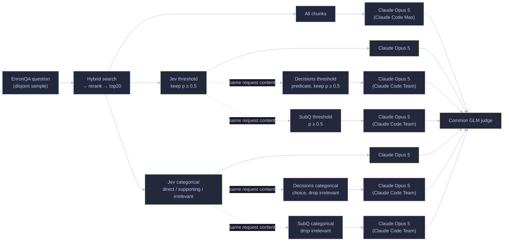
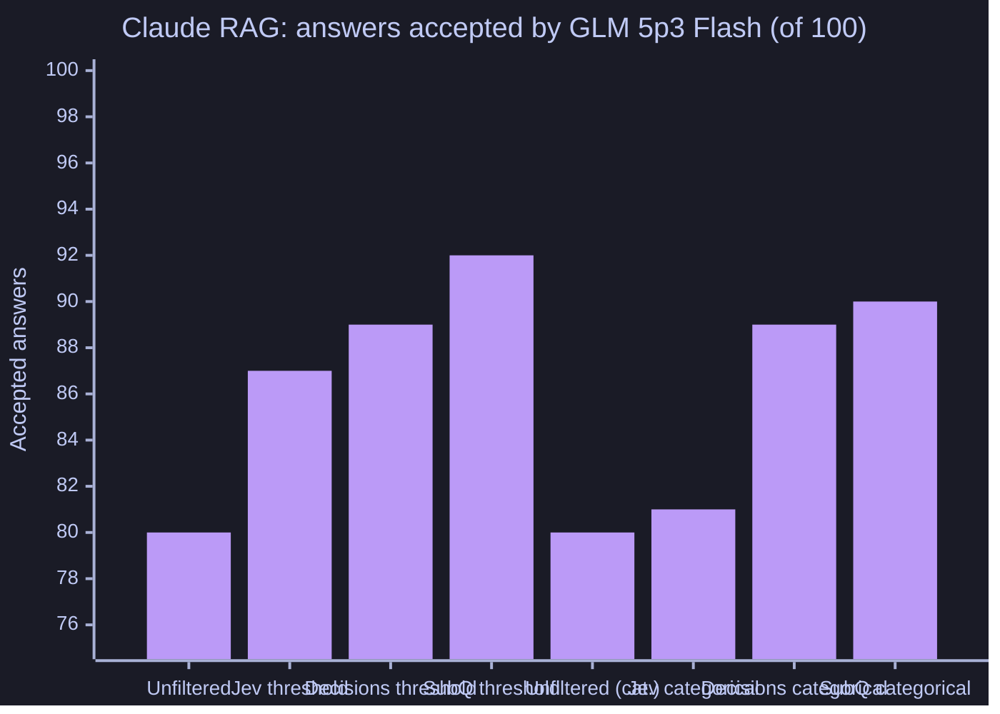

# Claude RAG filtering

## TL;DR

All three decision-model filters reduced the context sent to Claude, and the common GLM 5p3 Flash judge favored the filtered answers on this 100-question sample. In threshold mode, GLM accepted 80 unfiltered answers, 87 Jev-filtered, 89 Decisions-filtered, and 92 SubQ-filtered; Decisions and SubQ improved on baseline by +9 points [+2, +16] and +12 [+5, +19], while Jev's +7 interval touched zero [0, +14]. In categorical mode, the scores were 80, 81, 89, and 90, with Decisions +9 [+3, +15] and SubQ +10 [+3, +18]. SubQ retained 264 threshold chunks and 292 categorical chunks, compared with Jev's 322 and 420. These answer differences do not isolate the filter: baseline and Jev answers used Claude Code Max, whereas Decisions and SubQ used Team. GLM is also a model judge, not human ground truth, and used its supported low-reasoning mode. The results support substantial context reduction, but provider rankings remain confounded by route and sample.

Jev, OpenAI Decisions and SubQ Snap filter top20 reranked search results for Claude Opus 5. The baseline gets all chunks; treatments keep probability ≥0.5 or categories `direct_evidence` and `supporting_evidence` (discard `irrelevant`). Categorical mode uses no numerical cutoff. Whole chunks are paged under 6,000 proxy tokens, 24,000 bytes and six decisions.

Under a common GLM 5p3 Flash judge, threshold filtering scored 87/100 for Jev, 89/100 for Decisions, and 92/100 for SubQ, against 80/100 unfiltered. Categorical filtering scored 81, 89, and 90, against 80 unfiltered. Baseline and Jev answers used Claude Code Max, while Decisions and SubQ answers used Team, so route effects are confounded with filter effects. The sample differs from Kimi's and does not support a controlled comparison between answer models.

## How it works

All arms share retrieval. The threshold arm keeps chunks by probability; the categorical arm discards only `irrelevant` and has no numerical cutoff. Each decision-model provider receives the same filter-request content, and every filter has a corresponding Claude answer arm.

## Provider comparison

The filter is the only intended pipeline difference by decision-model provider. The [OpenAI adapter](../openai-decisions-adapter/README.md) maps threshold-mode Noul questions to predicates and categorical-mode questions to three-option choices, while the [SubQ adapter](../subq-adapter/README.md) sends the Jev-compatible requests directly. The 100 questions, cached searches, paging guards, Claude model and prompts, and judge prompt are shared.

**Two comparison caveats.** (1) *Claude route:* the Decisions- and SubQ-filtered arms used Claude Code on a Team subscription; the Jev and unfiltered arms used Claude Code Max. The model and prompts are the same, but route effects are confounded with filter effects. (2) *Judge:* GLM 5p3 Flash is thinking-only, so all 800 judgments use its supported low reasoning effort rather than the rejected `none` setting. State, prompt, temperature, strict JSON schema, and max-token cap are otherwise shared.

Source-free aggregates contain scores, paired intervals, judge agreement, and usage for [threshold mode](results/glm-5p3-threshold-common-judge-v1/rejudge-comparison.jsonl) and [categorical mode](results/glm-5p3-categorical-common-judge-v1/rejudge-comparison.jsonl).

| Mode | Unfiltered | Jev filter | Decisions filter | SubQ filter |
|---|---:|---:|---:|---:|
| Threshold, GLM accepted /100 | 80 | 87 | 89 | **92** |
| Categorical, GLM accepted /100 | 80 | 81 | 89 | **90** |

Paired differences from unfiltered under the common judge (cluster bootstrap by source document, 95%, descriptive) were, in threshold mode, Jev +7 points [0, +14], Decisions +9 [+2, +16], and SubQ +12 [+5, +19]. In categorical mode they were Jev +1 [−7, +8], Decisions +9 [+3, +15], and SubQ +10 [+3, +18].

The filter-agreement comparison uses identical frozen chunks:

| Mode | Jev kept | Decisions kept | SubQ kept | Decisions/Jev agreement | SubQ/Jev agreement | SubQ cost |
|---|---:|---:|---:|---:|---:|---:|
| Threshold | 322 | 249 | 264 | 94.7% | **95.9%** | $0.0887 |
| Categorical | 420 | 311 | 292 | **92.3%** | 91.9% | $0.0992 |

All 823 SubQ filter requests succeeded on the first attempt. Median round trips were 0.308 s in threshold mode and 0.270 s in categorical mode.

**Filter agreement.** On 2,000 byte-identical chunk decisions, threshold mode agreed with Jev on 94.7% of keep/drop decisions (κ 0.78; probability correlation 0.91), keeping 249 vs. 322; categorical mode agreed on 92.3% (κ 0.74), keeping 311 vs. 420. In categorical mode Decisions moved most of Jev's `supporting_evidence` chunks to `irrelevant` (112 of 169). Source-document coverage of the initial search was 97 before and 96 of 100 after filtering in both modes.

**Decisions as the answer judge.** Under the [Jev rescore](results/jev-rescore-v1/summary.json) protocol on the same 200 answers, Decisions accepted 89 unfiltered and 86 Jev-filtered answers. It agreed with the frozen DeepSeek verdicts on 184 of 200 (κ 0.50; all 16 disagreements were answers DeepSeek accepted and Decisions rejected), where Jev agreed on 178 of 200. It agreed with Jev's rescoring on 176 of 200 (κ 0.50). The 200 requests had 0 refusals and cost $0.021.

**SubQ as the answer judge.** On the same 200 saved answers, SubQ accepted 93 unfiltered and 90 Jev-filtered answers. It agreed with DeepSeek on 192/200 judgments (κ 0.67) and with Jev's rescoring on 182/200 (κ 0.58). All requests succeeded on the first attempt and cost $0.0107.

**Refusals: 0** for Decisions and SubQ in filtering and rescoring. No SubQ request failed or retried.

**Cost and latency.** The Decisions filter cost $0.19 (threshold, 415 pages) and $0.20 (categorical, 424 pages) at $0.10 per million input tokens. Because it returned fewer chunks, Claude read less: the whole Decisions-filtered pipeline came to $5.15 and $5.98 against $6.21 and $7.44 with the Jev filters and $26.91 unfiltered. Claude costs are API-equivalent list estimates, not subscription charges. The answer stage (filtering, Claude and follow-up searches) took a median 3.1 s and 3.3 s against 5.1 s and 5.2 s for the Jev arms, but on a different Claude route and under different service conditions, so that difference is not attributable to the filter.

**Caveats.** There are 100 questions per mode; GLM, Jev, Decisions, and SubQ verdicts are model assessments, not human truth; the filter prompts were written for Jev; and the Claude route differs between arms. Source-free aggregates: [Decisions](results/openai-decisions-v1/README.md) · [SubQ](results/subq-v1/README.md).

## Reproduce

See [shared setup and limits](../../REPRODUCTION.md). From this directory, build with `go build ./...`, run synthetic checks with `go test ./...`, and inspect CLI help before any paid run. Numerical reports are under `results/`. No original receipt archive is required or available in this distribution.
