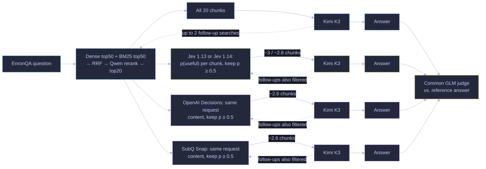
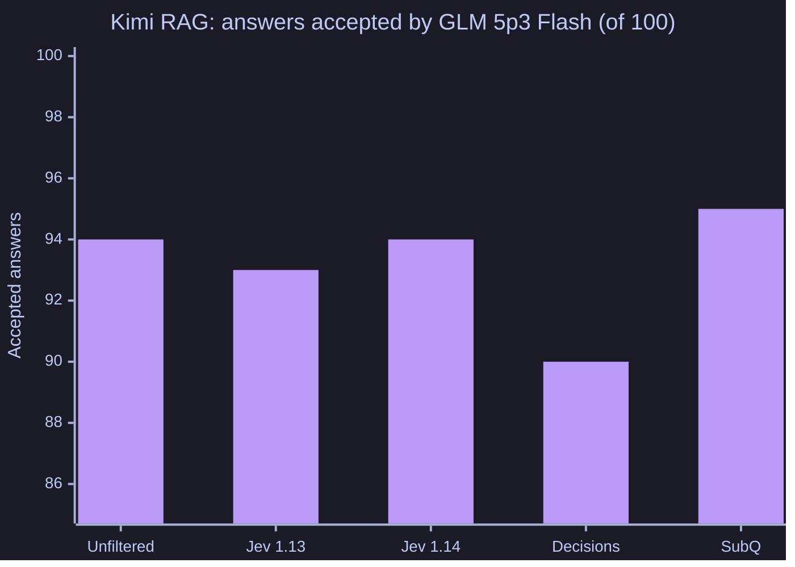

# Kimi RAG filtering

## TL;DR

With DeepSeek v4p1 judging every arm, Kimi answered 97/100 correctly using [Rune](https://fireworks.ai/models/fireworks/rune)’s filter, versus 96/100 with Jev 1.13 and 96/100 unfiltered. Rune − Jev was +1 pp [−2, +5], a descriptive paired 95% interval. Rune kept 389 chunks and cut Kimi input by 78%; estimated pipeline cost was $1.87 per 100 questions, versus $1.65 with Jev and $5.06 unfiltered.

Filtering cut the estimated cost of the Kimi pipeline by about two-thirds, with no clear loss in answer quality on this 100-question sample. Under one common GLM 5p3 Flash judge, SubQ-filtered answers scored highest at 95/100. Unfiltered and Jev 1.14-filtered answers scored 94, Jev 1.13-filtered 93, and Decisions-filtered 90. None of the paired differences from unfiltered excluded zero: SubQ was +1 point [−3, +5], Jev 1.14 0 [−5, +5], Jev 1.13 −1 [−7, +5], and Decisions −4 [−11, +2]. Jev 1.14 − Jev 1.13 was +1 [−2, +5], and a second all-arm GLM pass moved individual arms by up to 3 points. Jev 1.13 kept 307 of 2,020 chunks, Jev 1.14 kept 283 of 2,000, SubQ kept 267 of 2,020, and Decisions kept 263 of 2,040. On identical keep/drop decisions, Jev 1.14, SubQ and Decisions agreed with Jev 1.13 on 98.25%, 96.0% and 95.6% of chunks. Estimated whole-pipeline costs were $1.60–$1.69 for the filtered arms, against $5.06 unfiltered. GLM is a model judge rather than human ground truth, and all judgments used its supported low-reasoning mode. These results therefore support the cost reduction more strongly than any ranking of the filters.

Jev 1.13 (`jev-1.13.0`), Jev 1.14 (`jev-1.14.0`), OpenAI Decisions and SubQ Snap score retrieved chunks and return only those with relevance probability ≥0.5 to Kimi K3. Dense top50 + BM25 top50 → RRF → Qwen rerank → top20. All arms share initial retrieval; Kimi may make up to three searches. Whole chunks are paged under 6,000 proxy tokens, 24,000 bytes and six decisions.

On 100 paired questions, a common GLM 5p3 Flash judge accepted 94 unfiltered answers, 93 Jev 1.13-filtered answers, 94 Jev 1.14-filtered answers, 90 Decisions-filtered answers, and 95 SubQ-filtered answers. Estimated answering-pipeline model cost fell from $5.06 unfiltered to $1.60–$1.69 with filtering. These are model judgments and list-price estimates, not human truth or invoices. Costs include answering, filtering, embedding and reranking; exclude judging, indexing and infrastructure.

| Pipeline | Mean question-to-final-answer time |
|---|---:|
| Unfiltered | 5.50 s |
| Jev 1.13 filtered | 4.82 s |

Timing begins with the first Kimi request and ends with the final answer. It excludes initial retrieval/filtering and grading, includes intervening follow-up searches, and reflects eight concurrent question workers. This is observed speed, not a controlled latency comparison. Timings for the other filter arms were measured under different service conditions and are reported with each provider below.

## How it works

The upper branch is the baseline; the other branches apply Jev 1.13, Jev 1.14, OpenAI Decisions or SubQ filtering. All share the initial retrieval. Chunk counts are observed means per result set (Jev 1.13 3.04, Jev 1.14 2.83, Decisions 2.6, SubQ 2.64), not limits.

## Provider comparison

The filter is the only pipeline component that differs by decision-model provider or version. Both Jev versions receive the identical filter pages, with only the pinned `model` differing (`jev-1.13.0` or `jev-1.14.0`). The [OpenAI adapter](../openai-decisions-adapter/README.md) maps each chunk's Noul question to a predicate, while the [SubQ adapter](../subq-adapter/README.md) sends the Jev-compatible request directly. All providers keep a chunk at p ≥ 0.5. The 100 questions, cached initial searches, paging guards, Kimi K3 model and prompts, and judge prompts are shared.

**Common judge.** GLM 5p3 Flash judged every arm's saved answers (500 answers) with the same state, prompt, temperature, strict JSON schema, and max-token cap. The model is thinking-only, so all judgments use its supported low reasoning effort rather than the rejected `none` setting. The [source-free aggregate](results/glm-5p3-common-judge-v1/rejudge-comparison.jsonl) contains scores, paired intervals, judge agreement, and usage for the unfiltered, Jev 1.13, Decisions and SubQ arms; the [Jev 1.14 aggregate](results/jev-1.14.0-v1/README.md) adds the Jev 1.14 arm and a judge-repeatability pass.

| Pipeline | GLM accepted /100 | Chunks kept | Estimated model cost |
|---|---:|---:|---:|
| Unfiltered | 94 | all 20 per search | $5.06 |
| Jev 1.13 filter | 93 | 307 of 2,020 | $1.65 |
| **Jev 1.14 filter** | **94** | 283 of 2,000 | $1.63 |
| **Decisions filter** | **90** | 263 of 2,040 | $1.69 |
| **SubQ filter** | **95** | 267 of 2,020 | **$1.60** |

Paired differences from unfiltered under the common judge (cluster bootstrap by source document, 95%, descriptive) were Jev 1.13 −1 point [−7, +5], Jev 1.14 0 [−5, +5], Decisions −4 [−11, +2], and SubQ +1 [−3, +5]. Jev 1.14 − Jev 1.13 was +1 [−2, +5]; only 3 of the 100 questions received different verdicts in the two Jev arms. None of the intervals excludes zero.

**Judge repeatability.** A second GLM pass scored the unfiltered, Jev 1.13 and Jev 1.14 answers 91, 95 and 94. In that pass Jev 1.14 − Jev 1.13 was −1 [−5, +2], Jev 1.14 − unfiltered +3 [−2, +8], and Jev 1.13 − unfiltered +4 [−1, +10]. On identical answers the two GLM passes agreed on 97/100 unfiltered and 98/100 Jev 1.13 verdicts. Judge variation of up to 3 points per arm is therefore as large as the differences between filters in this sample.

**Filter agreement.** On 2,020 byte-identical chunk decisions, Decisions kept 262 and Jev 1.13 307; they agreed on 95.6% of chunks (Cohen's κ 0.82), with 67 chunks kept only by Jev 1.13 and 22 only by Decisions, and a mean probability difference of 0.08. Initial-search source coverage fell from 100 to 95 of 100 questions after Decisions filtering. Counting its two additional search result sets, Decisions kept 263 of 2,040 chunks (12.9%).

On the same 2,020 decisions, SubQ kept 267 chunks and agreed with Jev 1.13 on 96.0% (κ 0.84), with 60 chunks kept only by Jev 1.13 and 20 only by SubQ. Initial-search source coverage remained 100/100.

The two Jev versions were the closest pair of filters. On the 2,000 decisions of the 100 initial result sets, Jev 1.14 kept 283 chunks and Jev 1.13 306. They agreed on 98.25% (κ 0.930), with 29 chunks kept only by Jev 1.13, 6 only by Jev 1.14, and a mean probability difference of 0.028. Nineteen result sets got a different keep set. Kimi made no follow-up searches in the Jev 1.14 arm, so its totals cover those 100 result sets. Initial-search source coverage remained 100/100.

**Refusals: 0** for Decisions and SubQ. All 407 SubQ filter requests and all 403 Jev 1.14 filter requests succeeded on the first attempt; no request failed, and every Jev 1.14 response reported `jev-1.14.0`.

**Cost and latency.** The Decisions filter billed 1.85M input tokens, $0.185 at $0.10 per million, so the whole Decisions-filtered answering pipeline came to $1.69 for 100 questions against $1.65 with Jev 1.13 filtering and $5.06 unfiltered (list-price estimates covering answering, filtering, embedding and reranking). Decisions would match Jev 1.13's pipeline cost at about $0.077 per million input tokens. A filter page took 0.13 s at the median (p95 0.20 s). Kimi's question-to-final-answer time averaged 3.94 s for the Decisions arm, measured under different service conditions from the Jev 1.13 and unfiltered arms' 4.82 s and 5.50 s, so it is not a controlled latency comparison.

The SubQ filter used 1.75M input tokens and cost $0.0877 at $0.05 per million; its estimated whole-pipeline cost was $1.60. Median filter-page round trip was 0.307 s, and Kimi answer-stage latency averaged 5.47 s under different service conditions, so cross-provider timing is descriptive.

The Jev 1.14 filter used 1,747,588 input tokens on 403 pages and cost $0.0734 at $0.042 per million, against 1,762,053 tokens and $0.0740 for Jev 1.13 on its 407 pages. Because it kept fewer chunks, Kimi read 231,515 input tokens instead of 247,705, and the estimated whole-pipeline cost was $1.63. Jev 1.14 filter pages averaged 0.091 s (p50 0.090 s, p90 0.103 s), against 0.161 s (p50 0.140 s) for Jev 1.13. Kimi answer time, including the initial filter stage, averaged 5.06 s for Jev 1.14, 5.65 s for Jev 1.13 and 5.53 s unfiltered. The Jev 1.14 timings were measured under different service conditions, so this is descriptive.

**Caveats.** This is one 100-question sample; GLM and Jev judgments are model assessments, not human truth; the filter prompt was written for Jev; and the paired intervals are descriptive. GLM's variation across passes is as large as the differences between filters, so the study cannot rank Jev 1.13 against Jev 1.14. Each filter arm's Kimi answers are separate generations, so Kimi's own variation is part of every arm difference. Source-free aggregates: [Jev 1.14](results/jev-1.14.0-v1/README.md) · [Decisions](results/openai-decisions-v1/README.md) · [SubQ](results/subq-v1/README.md).

### Answer quality under DeepSeek v4p1

| Pipeline | Accepted /100 | Kimi input tokens | Estimated pipeline cost |
|---|---:|---:|---:|
| Unfiltered | 96 | 1,395,339 | $5.06 |
| Jev 1.13 filter | 96 | 247,705 | $1.65 |
| Rune filter | 97 | 306,578 | $1.87 |

Rune uses the same frozen retrieval pages, 100 questions, prompts and threshold via the [Fireworks client](../fireworks-systemone-adapter/README.md). All 407 filter pages succeeded on their first attempt. The original DeepSeek 0731 judge is retired; this panel applies v4p1 to all three arms and must be interpreted separately from the GLM comparison above. Source-document paired bootstrap intervals use 5,000 resamples (seed 20260918). [Source-free scores and contrasts](results/rune-v1/summary.json) contain no answers. Model judgments are not human ground truth. Rune costs use $0.042/M input; Kimi/reranking/embedding use the rate card described above, excluding judges and index setup. Worker counts and service load differ, so latency is descriptive. Identical filter requests agreed on 97.3% of chunks across repeated collections (κ 0.91).

## Reproduce

See [shared setup and limits](../../REPRODUCTION.md). From this directory, build with `go build ./...`, run synthetic checks with `go test ./...`, and inspect CLI help before any paid run. Numerical reports are under `results/`. No original receipt archive is required or available in this distribution.
