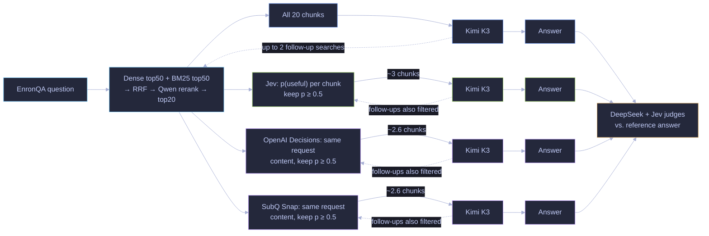
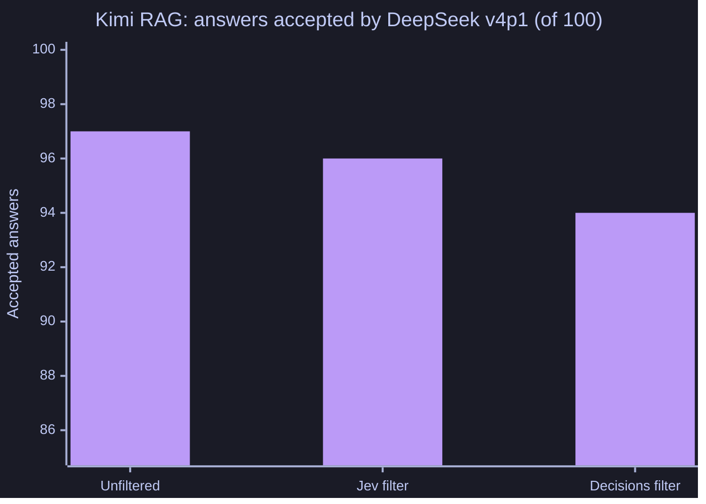

# Kimi RAG filtering

Jev, OpenAI Decisions and SubQ Snap score retrieved chunks and return only those with relevance probability ≥0.5 to Kimi K3. Dense top50 + BM25 top50 → RRF → Qwen rerank → top20. All arms share initial retrieval; Kimi may make up to three searches. Whole chunks are paged under 6,000 proxy tokens, 24,000 bytes and six decisions.

On 100 paired questions, DeepSeek accepted 98/100 in both arms; Jev accepted 90/100 baseline and 94/100 filtered. Estimated answering-pipeline model cost fell from $5.0632 to $1.6509; 307/2020 chunks were retained. These are model judgments and list-price estimates, not human truth or invoices. Costs include answering, filtering, embedding and reranking; exclude judging, indexing and infrastructure.

| Pipeline | Mean question-to-final-answer time |
|---|---:|
| Unfiltered | 5.50 s |
| Jev filtered | 4.82 s |

Timing begins with the first Kimi request and ends with the final answer. It excludes initial retrieval/filtering and grading, includes intervening follow-up searches, and reflects eight concurrent question workers. This is observed speed, not a controlled latency comparison.

## How it works

The upper branch is the baseline; the other branches apply Jev, OpenAI Decisions or SubQ filtering. All share the initial retrieval. Chunk counts are observed means per result set (Jev 3.04, Decisions 2.6, SubQ 2.64), not limits.

## Provider comparison

The filter is the only pipeline component that differs by decision-model provider. The [OpenAI adapter](../openai-decisions-adapter/README.md) maps each chunk's Noul question to a predicate, while the [SubQ adapter](../subq-adapter/README.md) sends the Jev-compatible request directly. All providers keep a chunk at p ≥ 0.5. The 100 questions, cached initial searches, paging guards, Kimi K3 model and prompts, and judge prompts are shared.

**Common judge.** The frozen DeepSeek judge model (`deepseek-v4-flash-0731`) is retired by its host. The three-arm comparison uses `deepseek-v4p1-flash` with the same prompt and request shape. On the 200 answers scored by both judge versions, they agreed 197 times (κ 0.72); the three disagreements were all accepted by v4 Flash and rejected by v4p1.

| Pipeline | DeepSeek v4p1 accepted /100 (same judge, all arms) | Frozen DeepSeek /100 | Jev judge /100 | Chunks kept | Estimated model cost |
|---|---:|---:|---:|---:|---:|
| Unfiltered | 97 | 98 | 90 | all 20 per search | $5.06 |
| Jev filter | 96 | 98 | 94 | 307 of 2,020 | $1.65 |
| **Decisions filter** | **94** | n/a | 89 | 263 of 2,040 | $1.69 |
| **SubQ filter** | n/a | n/a | **94** | 267 of 2,020 | **$1.60** |

The DeepSeek model used for the SubQ arm differs from the common v4p1 judge used in the first three rows, so its DeepSeek verdicts are excluded. The Jev-judge column is directly comparable across all four arms: unfiltered 90, Jev-filtered 94, Decisions-filtered 89, and SubQ-filtered 94.

Paired differences under the same judge (cluster bootstrap by source document, 95%, descriptive): Decisions minus Jev −2 points [−5, 0] (Jev alone correct on 2 questions, Decisions alone on none); Decisions minus unfiltered −3 [−8, +1]; Jev minus unfiltered −1 [−5, +2].

**Filter agreement.** On 2,020 byte-identical chunk decisions, Decisions kept 262 and Jev 307; they agreed on 95.6% of chunks (Cohen's κ 0.82), with 67 chunks kept only by Jev and 22 only by Decisions, and a mean probability difference of 0.08. Initial-search source coverage fell from 100 to 95 of 100 questions after Decisions filtering. Counting its two additional search result sets, Decisions kept 263 of 2,040 chunks (12.9%).

On the same 2,020 decisions, SubQ kept 267 chunks and agreed with Jev on 96.0% (κ 0.84), with 60 chunks kept only by Jev and 20 only by SubQ. Initial-search source coverage remained 100/100.

**Refusals: 0** for Decisions and SubQ. All 407 SubQ filter requests succeeded on the first attempt; no request failed.

**Cost and latency.** The Decisions filter billed 1.85M input tokens, $0.185 at $0.10 per million, so the whole Decisions-filtered answering pipeline came to $1.69 for 100 questions against $1.65 with Jev filtering and $5.06 unfiltered (list-price estimates covering answering, filtering, embedding and reranking). Decisions would match Jev's pipeline cost at about $0.077 per million input tokens. A filter page took 0.13 s at the median (p95 0.20 s). Kimi's question-to-final-answer time averaged 3.94 s for the Decisions arm, measured under different service conditions from the Jev and unfiltered arms' 4.82 s and 5.50 s, so it is not a controlled latency comparison.

The SubQ filter used 1.75M input tokens and cost $0.0877 at $0.05 per million; its estimated whole-pipeline cost was $1.60. Median filter-page round trip was 0.307 s, and Kimi answer-stage latency averaged 5.47 s under different service conditions, so cross-provider timing is descriptive.

**Caveats.** 100 questions, one sample; DeepSeek and Jev judgments are model assessments, not human truth; judge versions differ, so only same-judge numbers are compared; the filter prompt was written for Jev. Source-free aggregates: [Decisions](results/openai-decisions-v1/README.md) · [SubQ](results/subq-v1/README.md).

## Reproduce

See [shared setup and limits](../../REPRODUCTION.md). From this directory, build with `go build ./...`, run synthetic checks with `go test ./...`, and inspect CLI help before any paid run. Numerical reports are under `results/`. No original receipt archive is required or available in this distribution.
