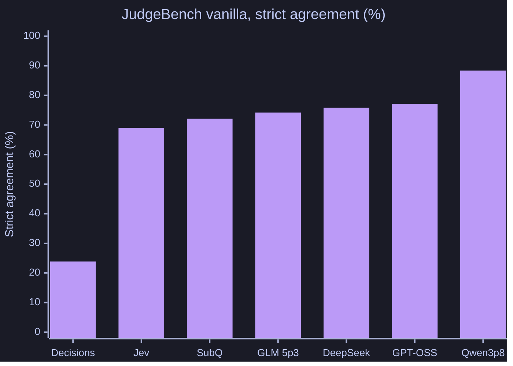

# Decision models vs. LLM judges

Compare Jev, OpenAI Decisions, SubQ Snap and four LLM judges on benchmark-label agreement, service failures, latency, tokens, estimated cost and selective routing across LLMBar, JudgeBench and RewardBench 2. Agreement with benchmark labels is not independently verified correctness. Native decision-model interfaces and established LLM judging protocols are distinguished in the Go harness.

[Aggregate measurements](results/primary/) retain numerical quality, reliability, native-interface comparisons and rating sensitivity. Benchmark examples, submitted answers, frozen request receipts and full archives are not bundled. The private originals remain unchanged; numerical projections cannot substitute for receipt-level audit.

`go run ./cmd/evalevaluation --help` lists the CLI. `go run ./cmd/evalevaluation prepare` acquires pinned upstream sources into the local ignored cache with hash verification. Configs and runtime third-party adapters are included with their licenses. Provider-backed campaign commands incur costs; use a new output directory. The official-data replay integration test requires private receipt fixtures and is skipped in this source-free distribution.

## How it works

Every judge sees the same examples through the same protocol adapter. The cascade is simulated offline from the recorded outputs, with thresholds chosen on development cases. The [OpenAI adapter](../openai-decisions-adapter/README.md) maps pairwise questions to `choice`, ratings to `score`, and Atomic Noul questions to predicates without changing the judged text. The [SubQ adapter](../subq-adapter/README.md) sends the shared Jev-compatible content directly.

## Reproduce

See [shared setup and limits](../../REPRODUCTION.md). From this directory, build with `go build ./...`, run synthetic checks with `go test ./...`, and inspect CLI help before any paid run. Numerical reports are under `results/`. No original receipt archive is required or available in this distribution.

## Provider comparison

The 19 primary methods contain 11,255 jobs, and the native Compact and Atomic interfaces contain 838. Samples, typed question content, option order, analysis plan, and GPT-OSS helper outputs are shared across decision-model providers.

| Judge | LLMBar Vanilla | JudgeBench vanilla | RewardBench 2 ratings |
|---|---:|---:|---:|
| **OpenAI Decisions** | **79.16%** | **23.87%** | **61.32%** |
| **SubQ Snap** | **88.06%** | **72.10%** | **69.39%** |
| Jev | 87.36% | 69.03% | 68.12% |
| GPT-OSS 120B | 87.05% | 77.10% | 79.56% |
| DeepSeek V4 Flash | 88.73% | 75.81% | 65.99% |
| GLM 5p3 | 91.18% | 74.19% | 27.59% |
| Qwen3p8 Max | 92.53% | 88.39% | 81.57% |

These scores apply the same service-retry policy and charge every attempt. Required-stage failures score zero. Decisions and SubQ needed no separate service-error recovery pass. LLMBar/RewardBench average subsets equally; JudgeBench pools cases. Compare within a column. [Retry results](results/primary-recovery-analysis-v1/service-recovery.json) are reported separately from the primary metrics.

An offline Jev → GPT-OSS cascade on 513 held-out JudgeBench cases scored 80.12% versus 76.41% for GPT-OSS alone, with 43.69% lower accounting cost. The paired gain was 3.70 points (95% interval 1.17–6.43). This simulation uses original unrecovered outputs and development-selected thresholds; timing adds separately measured calls. Other pairings lost quality: the LLMBar → Qwen cascade lost 3.52 points. [All cascade measurements](results/cascade-evaluation-v1/cascades.json). Prices are dated list estimates, not invoices; intervals are unadjusted for multiple comparisons.

**SubQ across all methods.** SubQ's primary strict scores ranged from 68.23% on JudgeBench arena_hard to 89.76% on LLMBar Vanilla_2shot. Its point estimate exceeded Jev on 18 of 19 methods; ten paired 95% intervals excluded zero, including JudgeBench vanilla +4.35 points [+1.13, +7.58], LLMBar Vanilla_1shot +6.37 [+3.49, +9.34], and RewardBench 2 ratings +2.70 [+0.35, +5.12]. Native Compact scored 89.10% vs. Jev 87.43% (+1.67 [−1.00, +4.39]); Atomic scored 85.72% vs. 81.47% (+4.26 [+1.54, +7.16]). Intervals are paired, 2,000-replicate bootstrap and unadjusted for 21 comparisons.

**All 19 methods.** On LLMBar, Decisions scored 67.72% (Vanilla_1shot) to 87.46% (Rating_Metrics_Reference). It beat Jev on all five LLMBar rating methods (Rating, Rating_Metrics, Rating_Metrics_Reference, Rating_NoRules and Rating_Reference: +1.2 to +5.1 points; three intervals exclude zero, for example Rating_Metrics_Reference +5.05 [+2.28, +8.03]), and lost on every pairwise method (−4.3 to −14.0 points, all intervals below zero). On RewardBench 2 it was 6.4 (fourway) and 5.4 (ratings) points below Jev; on JudgeBench arena_hard, 40.81% vs. 65.97%. Native interfaces: Compact 77.86% vs. Jev 87.43% (−9.56 [−12.72, −6.47]); Atomic 76.72% vs. 81.47% (−4.75 [−7.60, −1.85]). Intervals are paired, 2,000-replicate bootstrap, unadjusted for 21 comparisons.

**Why JudgeBench collapsed: first-position bias.** Each pair is judged in both presentation orders. Decisions picked whichever response was shown first, in both orders, on 441 of 620 JudgeBench vanilla pairs (71.1%) and never picked the second-shown response in both orders. Jev did the first on 40 pairs (6.5%) and the second on 35.

| Pairs where the judge picked the same *position* in both orders | Decisions: first shown | Decisions: second shown | Jev: first shown | Jev: second shown |
|---|---:|---:|---:|---:|
| JudgeBench vanilla (620 pairs) | 441 (71.1%) | 0 | 40 (6.5%) | 35 |
| JudgeBench arena_hard (620) | 206 (33.2%) | 25 | 33 (5.3%) | 36 |
| LLMBar Vanilla (419) | 102 (24.3%) | 0 | 27 (6.4%) | 7 |

Picking the same position in both orders means the two verdicts contradict each other, so at most one of them can agree with the label. JudgeBench pairs are long, hard responses to reasoning, math and code questions, where this bias dominated. The four LLM judges picked the first-shown response in both orders on 0.8% to 4.7% of JudgeBench vanilla pairs.

SubQ picked the first-shown response in both orders on 57/620 JudgeBench vanilla pairs (9.2%), the second-shown response on 12, and made an order-consistent choice on 551. Its corresponding counts were 42/38/537 on JudgeBench arena_hard and 12/3/404 on LLMBar Vanilla. The order effect is measurable but far smaller than Decisions' JudgeBench collapse.

**Calibration.** On the two binary choice methods, Decisions' first-order probabilities were less calibrated than Jev's: JudgeBench vanilla Brier 0.282 / ECE 0.257 (Jev 0.164 / 0.088); LLMBar Vanilla 0.157 / 0.153 (Jev 0.089 / 0.046).

SubQ's first-order probabilities were similarly calibrated to Jev: JudgeBench vanilla Brier 0.157 / ECE 0.066 and LLMBar Vanilla 0.083 / 0.047.

**Decisions-first cascades.** The four preregistered cascades use Decisions as the first stage, with thresholds selected on the development fold and evaluated once on held-out cases. None improved on the fallback alone: JudgeBench → GPT-OSS 76.02% vs. 76.41% (−0.39 [−2.34, +1.56]) at 0.99× the cost, where the Jev-first cascade gained 3.70 points at 43.69% lower cost; JudgeBench → Qwen −2.73 [−4.29, −1.17]; LLMBar → GPT-OSS −1.07 [−3.36, +1.02] at 0.72× the cost; LLMBar → Qwen −0.77 [−1.94, 0.00] at 0.70× the cost.

**SubQ-first cascades.** JudgeBench → GPT-OSS accepted 87.5% at the first stage, scored 78.56% vs. 76.41% for GPT-OSS alone (+2.14 [−1.75, +5.85]), and cost 0.26× as much under accounting that includes shared helpers. LLMBar → GPT-OSS scored 88.86% vs. 87.38% (+1.48 [−1.52, +4.69]) at 0.26× cost. Neither interval excludes zero. The Qwen fallbacks lost 1.17 and 2.93 points respectively, with intervals touching zero.

**Refusals and service failures.** Decisions refused **159 requests, all on RewardBench 2**: 23 fourway requests (23 invalid jobs) and 136 rating requests (70 invalid jobs). Refusals are never retried or given a value, so a refused required stage scores zero, like a service failure. There were no refusals on LLMBar, JudgeBench or the native interfaces. Service errors were negligible: 5 transient attempts (four HTTP 503, one 504) in about 30,000 requests, all recovered by the in-run retry, so no Decisions job needed the service-error pass; the Jev arm sent 207 jobs to it.

SubQ completed 29,487 requests with no refusal, invalid job, retry, HTTP error or service-recovery job.

**Cost and latency.** The Decisions arm billed 28.4M input tokens, **$2.84** at $0.10 per million (output is not billed); the accounting total of $3.41 adds the shared GPT-OSS helper calls ($0.63) at their recorded prices. Jev accounting was $2.21 including the same helpers. Median request time was 0.12 s for both Decisions and Jev; Decisions' median job time (3.2 s vs. Jev's 0.27 s) reflects client-side pacing, not model latency.

SubQ billed 26.65M input tokens, an estimated **$1.33** at $0.05 per million; its $1.96 accounting total includes the reused GPT-OSS helpers. Median round trips were 0.175 s for primary requests and 0.222 s for native-interface requests. Provider routes and loads differ, so cross-provider latency is descriptive.

**Verification.** Because the JudgeBench score is so low, the pipeline was checked against the live API on a seeded sample of 100 JudgeBench vanilla pairs in both orders (about $0.15 of requests):

| Check | Result |
|---|---|
| Replay of the frozen requests | 200/200 identical answers: the run recorded what the API returns, and Decisions is deterministic |
| Truncation | Ruled out: no request exceeds about 4k tokens, and first-shown picks are most frequent on the shortest inputs (73% under 1k tokens) |
| 20 blatantly easy pairs in the same template and format, both orders | 40/40 correct, no first-shown picks, confidence ≈ 1.0, so both outputs are read and the A/B mapping is right |
| Input as a readable transcript instead of the frozen JSON state | first-shown in both orders 70% → 64%; strict agreement 27% → 29% |
| Input as native Decisions messages | 62%; 32% |
| Readable input plus a self-contained question (protocol deviation, diagnostic only) | 52%; 38% |

The bias is the model's behavior on hard pairs, not a harness error. The shared Jev-style framing costs Decisions a few points, far short of Jev's 69.03%. Of the 93 invalid RewardBench 2 jobs, 92 are in the Safety subset (refused harmful prompts), none in Math, Factuality or Precise IF.

**Caveats.** Agreement with benchmark labels is not verified correctness. Prompts and protocols were designed for Jev and fixed before evaluation; Decisions and SubQ were not given position-debiased or provider-tuned prompts. Provider measurements used different services and service conditions. Source-free aggregates for [Decisions](results/openai-decisions-v1/README.md) and [SubQ](results/subq-v1/README.md) include per-method scores, deltas, reliability, position-bias counts and cascades.
