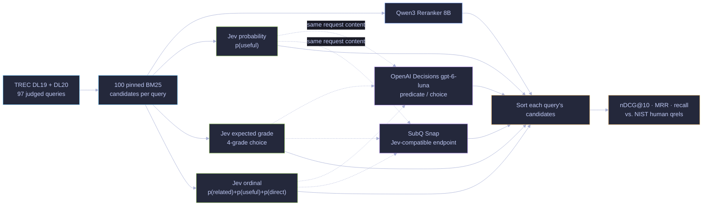
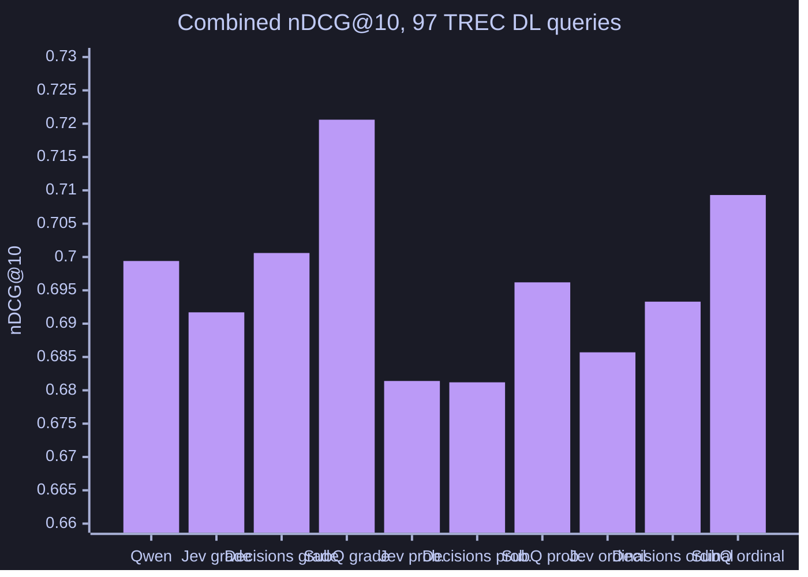

# Decision models vs. rerankers

Compare Qwen3 Reranker 8B with general-purpose decision-model probability, expected-grade and ordinal scores over the same 100 BM25 candidate passages for all 97 TREC DL 2019/2020 judged queries. Human qrels determine nDCG@10, MRR and recall; no answer-model judge is involved. SubQ's expected-grade score reached nDCG@10 0.7206, compared with 0.7006 for OpenAI Decisions, 0.6994 for Qwen and 0.6917 for Jev. This small public benchmark does not establish general superiority or equivalence.

## TL;DR

SubQ produced the best relevance ranking in this 97-query TREC DL comparison: its expected-grade score reached 0.7206 nDCG@10, ahead of Decisions at 0.7006, Qwen3 Reranker 8B at 0.6994, and Jev at 0.6917. Against Jev, SubQ's expected-grade gain was +0.0289 with a 95% interval of [+0.0124, +0.0470]; its +0.0212 interval against Qwen narrowly included zero. Expected grade was the strongest frozen scoring formulation for every decision-model provider, while probability was weakest. Decisions roughly matched Qwen and Jev on the primary arms, and 23 refusals hurt one exploratory ordinal prompt. SubQ also had the lowest estimated list cost for its three primary arms, at $0.46 total versus $0.62 for Jev, $1.28 for Decisions, and $0.33 for Qwen. The benchmark is small, public, and potentially present in model training; prompt variants were inspected on the same queries, so the exploratory best-prompt results are not held-out validation.

Aggregate JSON retains cost, timing, coverage and ranking metrics; source-bearing candidate text and receipts are omitted.

After dependency bootstrap, `go run . prepare` downloads upstream data without inference. `go run . run --study prompts --out results/new-prompts --max-cost 20` performs paid inference. `report` and `audit` operate on your own locally generated receipts. Whole-query timing depends on batching and concurrency.

## How it works

BM25 order is the control and a label-based oracle measures the candidate-set ceiling. No answer model or LLM judge is involved. Each provider receives the same request content; the [OpenAI adapter](../openai-decisions-adapter/README.md) maps Noul questions to Decisions predicates and grade choices to Decisions choices, while the [SubQ adapter](../subq-adapter/README.md) validates and sends the Jev-compatible request directly.

## Provider comparison

Jev, OpenAI's [Decisions API](https://developers.openai.com/api/docs/guides/decisions) (`gpt-6-luna`, wire format `guide-2026-10-06`) and SubQ Snap receive the same content. For Decisions, Noul questions become predicates and the four-grade question becomes a choice whose per-option probabilities feed the shared expected-grade rule. Queries, candidates, qrels, prompts, tie handling, retry policy, metrics, and bootstrap are fixed across provider arms.

| Method | Combined nDCG@10 | DL19 | DL20 | MRR@10 | List cost (97 queries) |
|---|---:|---:|---:|---:|---:|
| Qwen3 Reranker 8B | 0.6994 | 0.7343 | 0.6716 | 0.8593 | $0.325 |
| Jev expected grade | 0.6917 | 0.7026 | 0.6831 | 0.8604 | $0.224 |
| **Decisions expected grade** | **0.7006** | 0.7088 | 0.6941 | 0.8561 | $0.318 |
| **SubQ expected grade** | **0.7206** | 0.7340 | 0.7099 | 0.8619 | $0.147 |
| Jev probability | 0.6814 | 0.6932 | 0.6721 | 0.8593 | $0.178 |
| Decisions probability | 0.6812 | 0.6844 | 0.6786 | 0.8595 | $0.306 |
| SubQ probability | 0.6962 | 0.7024 | 0.6912 | 0.8558 | $0.119 |
| Jev ordinal | 0.6857 | 0.7004 | 0.6740 | 0.8606 | $0.215 |
| Decisions ordinal | 0.6933 | 0.7111 | 0.6791 | 0.8562 | $0.658 |
| SubQ ordinal | 0.7093 | 0.7209 | 0.7001 | 0.8628 | $0.193 |
| BM25 order | 0.4912 | 0.5058 | 0.4796 | 0.6751 | – |

Paired differences (95% bootstrap over queries, stratified by year, individually unadjusted):

- Decisions expected grade minus Qwen: **+0.0012 [−0.0207, +0.0226]**; minus Jev expected grade: +0.0089 [−0.0082, +0.0280].
- Decisions probability minus Jev probability: −0.0002 [−0.0226, +0.0225]. Decisions ordinal minus Jev ordinal: +0.0076 [−0.0107, +0.0269].
- SubQ expected grade minus Qwen: **+0.0212 [−0.0006, +0.0419]**; minus Jev expected grade: **+0.0289 [+0.0124, +0.0470]**.
- SubQ probability minus Jev probability: +0.0148 [−0.0012, +0.0318]. SubQ ordinal minus Jev ordinal: **+0.0236 [+0.0080, +0.0410]**.

**Prompt study.** The nine exploratory variants scored 0.6563–0.6999 on Decisions, 0.6804–0.6962 on Jev and 0.6947–0.7208 on SubQ. SubQ's best observed variant was the short grade prompt at 0.7208, +0.0214 [+0.0004, +0.0410] over Qwen and +0.0340 [+0.0142, +0.0550] over the corresponding Jev arm. These are benchmark-selected results, not held-out prompt validation. Every prompt was written for Jev; none was tuned for Decisions or SubQ.

**Refusals.** Decisions refused the `related` predicate of the ordinal-statement prompt on 23 passages, spread over 13 queries. Under the frozen policy a refusal is never retried or given a value, and those 13 query jobs fell back to BM25 order. There were no refusals in the other eleven Decisions arms. Excluding the 13 affected queries (84 remain), ordinal-statement scores 0.6725 on Decisions vs. 0.6844 on Jev (−0.0119 [−0.0358, +0.0129]) and 0.6964 for Qwen: the fallback explains about two-thirds of that prompt's gap to Jev, not all of it.

**Cost and latency.** The twelve Decisions arms made 116,418 requests (18 transient failed attempts, all retried successfully) for **$5.30** at $0.10 per million input tokens. The twelve SubQ arms made 116,400 requests, all successful on the first attempt, and used 37.91 million billed input tokens for an estimated **$1.90** at $0.05 per million. The three primary SubQ arms used 9.18 million input tokens and cost an estimated **$0.46**. Median SubQ request latency was 0.17 s for one-question arms and 0.23 s for the three-question ordinal arm. Decisions' median request took 0.12 s (p95 about 0.4 s). Whole-query timings include provider-specific client pacing and are not directly comparable.

**Caveats.** 97 public queries that may overlap model training; intervals are individual, not familywise, and no equivalence is claimed; selecting any provider's best prompt after seeing results is not held-out validation; Decisions probabilities are rounded to 0.01; ties are broken by BM25 order for every provider. Source-free numbers are in [`results/openai-decisions-v1/`](results/openai-decisions-v1/README.md) and [`results/subq-v1/`](results/subq-v1/README.md).

## Reproduce

See [shared setup and limits](../../REPRODUCTION.md). From this directory, build with `go build ./...`, run synthetic checks with `go test ./...`, and inspect CLI help before any paid run. Numerical reports are under `results/`. No original receipt archive is required or available in this distribution.
