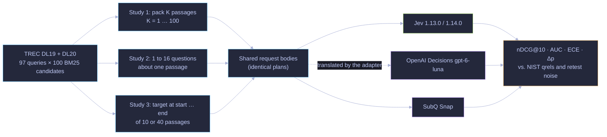

# Request shaping for decision models

**Question:** how should you shape a decision-model request? Pack many items into one state or send one at a time, ask many questions per request or one, and does it matter where the evidence sits in the state?

## TL;DR

[Rune](https://fireworks.ai/models/fireworks/rune) benefited from small packs (+0.0183 nDCG@10 at K=4) but not progressively larger packs, and packing saved requests without saving tokens. A 16,384-token packed-length limit excluded pack-100 and one pack-50 ordering. Co-asking related questions improved Rune’s ranking by about +0.02 nDCG@10; its retest mean |Δp| was 0.026–0.028, about 2.7× Jev 1.13’s. Position effects in long states were within roughly ±0.006 AUC.

Request shape changed model behavior, but the useful pattern depended on the provider. Packing 100 passages raised Jev 1.13 nDCG@10 by +0.036 and Jev 1.14 by +0.032, and cut input tokens per decision from 438 to 189 on both. Decisions gained only +0.015 with no token saving. SubQ gained +0.015 at 10 passages but could not run larger packed-question arms because of a 16-question service limit. Co-asked questions were effectively independent when the target came first. Mean probability changes matched each Jev version's retest noise (0.009 on 1.13, 0.012 on 1.14), were zero for Decisions, and were about 0.0001 for SubQ. SubQ's target moved about 0.013 when placed last among 16 questions. Long states showed no general “lost in the middle” effect. Both Jev versions lost a little AUC at the end of a 40-passage state, SubQ favored the start of that state by +0.0196 AUC over the middle, and putting the question before the state helped Decisions most. The two Jev versions agreed on these main findings and had the same ranking quality and token counts; Jev 1.14's probabilities ran 0.005 to 0.011 lower on average and its retest noise was about 30% higher. Practical guidance is therefore provider-specific: use named references, freeze layout and ordering, validate packing empirically, and do not treat multi-question independence as position independence.

Three controlled studies on TREC DL passage relevance, with human labels, compare two TypeSafe Jev versions (Jev 1.13, `jev-1.13.0`, and Jev 1.14, `jev-1.14.0`), OpenAI Decisions (`gpt-6-luna`), and SubQ Snap (`subq-snap-preview`) under the same plan. Every study uses the fixed relevance prompt from [`jev-vs-rerankers`](../jev-vs-rerankers/README.md):

1. **State packing** ([Jev 1.13 report](results/state-packing-v1/REPORT.md), [Jev 1.14 report](results/state-packing-jev-1.14.0/REPORT.md), [Decisions report](results/state-packing-openai-decisions-v1/REPORT.md), [SubQ report](results/state-packing-subq-v1/REPORT.md)): one passage per state compared with several passages sharing a state.
2. **Question fan-out** ([Jev 1.13](results/question-fanout-v1/REPORT.md), [Jev 1.14](results/question-fanout-jev-1.14.0/REPORT.md), [Decisions](results/question-fanout-openai-decisions-v1/REPORT.md), [SubQ](results/question-fanout-subq-v1/REPORT.md)): one question per request compared with several questions about the same state.
3. **Position in state** ([Jev 1.13](results/state-position-v1/REPORT.md), [Jev 1.14](results/state-position-jev-1.14.0/REPORT.md), [Decisions](results/state-position-openai-decisions-v1/REPORT.md), [SubQ](results/state-position-subq-v1/REPORT.md)): evidence at the beginning, middle, or end of the state.

**Status:** complete. Design and protocol: [SPEC.md](SPEC.md). Each study is its own Cobra CLI under `cmd/`. No LLM is involved anywhere; every model call is to a decision model. This experiment was developed under the name `jev-best-practices`.

## How it works



## Findings

The findings below are stated for Jev, with Jev 1.13 figures first and Jev 1.14 figures beside them. Decisions and SubQ follow under [Provider comparison](#provider-comparison).

### 1. Packing same-query passages into one state helps ranking and cuts requests

| K | Jev 1.13 Δ nDCG@10 vs. atomic | Holm p | Jev 1.14 Δ nDCG@10 vs. atomic | Holm p |
|---|---|---:|---|---:|
| 1 (`atomic`) | — (0.6782) | — | — (0.6827) | — |
| 2 | +0.0108 [−0.0021, +0.0241] | 0.103 | +0.0126 [−0.0009, +0.0275] | 0.069 |
| 4 | +0.0189 [+0.0046, +0.0338] | 0.020 | +0.0174 [+0.0029, +0.0333] | 0.029 |
| 10 | +0.0270 [+0.0112, +0.0429] | 0.0008 | +0.0217 [+0.0048, +0.0400] | 0.029 |
| 20 | +0.0292 [+0.0141, +0.0447] | < 0.001 | +0.0260 [+0.0088, +0.0446] | 0.010 |
| 50 | +0.0342 [+0.0157, +0.0530] | < 0.001 | +0.0335 [+0.0147, +0.0539] | 0.001 |
| 100 | +0.0362 [+0.0173, +0.0546] | 0.002 | +0.0318 [+0.0133, +0.0512] | 0.004 |

- **Ranking quality:** putting K candidates for the same query into one state, with one question per passage, raised nDCG@10 steadily with K. On Jev 1.13 the gain went from +0.011 (K = 2, not significant) to **+0.036 [+0.017, +0.055] at K = 100**, where all 100 candidates are in one request. Jev 1.14 followed the same curve and peaked at +0.034 at K = 50. On both versions the gain is significant after Holm correction for K ≥ 4.
- **Not a tie artifact:** Jev rounds probabilities to 0.01, but the gain holds when tied scores are ordered at random instead of by BM25: +0.041 at K = 100 on Jev 1.13 and +0.037 on Jev 1.14.
- **Binary discrimination:** AUC (grade ≥ 2 vs. the rest) is statistically unchanged at K = 100: +0.006 [−0.003, +0.015] on Jev 1.13 and +0.006 [−0.002, +0.014] on Jev 1.14.
- **Cost and speed:** requests fall K-fold. Input tokens per decision drop from 438 to 189 on both versions, because the question is billed once per request instead of once per passage. At K = 100 the median request time per decision drops from 91 ms to 2.0 ms on Jev 1.13, and from 70 ms to 1.7 ms on Jev 1.14.
- **Distraction vs. fan-out:** the change comes from the other passages in the state, not from the extra questions. On both versions, asking about only one passage in the same packed state (`single-K`) gives the same probabilities as asking about all of them.
- **Neighbors pull scores down slightly:** four relevant neighbors lower a target's probability compared with four non-relevant neighbors, whatever the target's own label. The shift is 0.026 [0.017, 0.035] on Jev 1.13 and 0.030 [0.020, 0.039] on Jev 1.14.
- **Order matters a little:** reversing a pack changes probabilities by a mean |Δp| of 0.041 on Jev 1.13, about four times its retest noise of 0.009. On Jev 1.14 the shift is 0.039, about three times its noise of 0.013.
- **Referencing passages:** named keys (`passages.p007`) and quoted ids work about equally well. Bare indices (`passages[6]`) inflate probabilities and worsen calibration on both versions (Jev 1.13: +0.014, ECE 0.188 vs. 0.169; Jev 1.14: +0.005, ECE 0.176 vs. 0.161). On Jev 1.14 they also lose most of the packing gain: +0.008 [−0.013, +0.029] at K = 10, against +0.025 with quoted ids.
- **Mixing unrelated queries** (`cross-K`) inflates probabilities and worsens calibration on both versions (ECE 0.205 to 0.229 vs. 0.181 on Jev 1.13; 0.205 to 0.220 vs. 0.178 on Jev 1.14). It still helps nDCG on Jev 1.13 (+0.017 to +0.020); the Jev 1.14 gains (+0.006 and +0.010) are not significant.

### 2. Co-question effects depend on the provider

Asking the target question alone, or alongside 2, 7, or 15 other questions, changed its probability by a mean |Δp| of 0.0093–0.0099 on Jev 1.13 and 0.0122–0.0127 on Jev 1.14. A plain retest of the solo request moves it by 0.0094 and 0.0122 respectively, so on both versions the difference is indistinguishable from noise. AUC is flat. On Jev 1.14 all eight fan-out contrasts in nDCG@10 have Holm p = 1.00. On Jev 1.13, one contrast survives Holm correction: the target asked last among 16 related questions gains +0.0086 [+0.0023, +0.0158] (p = 0.019), although its probabilities move no more than retest noise (|Δp| 0.0095). The three-question ordinal request is outside the Holm family. Its uncorrected nDCG interval excludes zero on Jev 1.14 (−0.016 [−0.033, −0.001]) but not on Jev 1.13. Neither of these effects appears on the other version. Asking the three ordinal questions together does not make the answers more coherent. On Jev 1.13, violations of direct ≤ useful ≤ related stay at about 2.5%. On Jev 1.14, p(direct) exceeds p(useful) for 8–10% of items in every arm, including the solo requests, and almost never by more than 0.1. Fan-out is cheap on both versions: 16 questions cost 815 input tokens against 435 for one.

### 3. Position in state

**No "lost in the middle."** A target passage was moved through five positions among 9 or 39 off-topic filler passages. On both versions the middle was never significantly worse than the start, and every 10-passage position stayed within ±0.003 AUC of the middle.

| 40-passage state, Δ AUC vs. middle | Jev 1.13 | Jev 1.14 |
|---|---|---|
| Pointed question, target at the end | −0.0077 [−0.0137, −0.0026] | −0.0052 [−0.0114, +0.0004] |
| Needle question, target at the end | −0.0090 [−0.0171, −0.0019] | −0.0091 [−0.0145, −0.0031] |
| Question field first, target at 25% | −0.0015 [−0.0053, +0.0017] | −0.0043 [−0.0086, −0.0007] |
| Question field first, target at the end | −0.0018 [−0.0070, +0.0030] | −0.0003 [−0.0049, +0.0036] |

Only the **end of the 40-passage state** was slightly worse. Putting the question field before the passages removed the end penalty on both versions and raised AUC a little (0.905 vs. 0.897 at the middle on Jev 1.13, 0.9027 vs. 0.8995 on Jev 1.14), at some cost in calibration. On Jev 1.14 it also brought a small penalty at the 25% position. Off-topic filler inflated non-relevant targets (on Jev 1.13, mean p 0.40 alone to 0.42–0.49) while relevant ones stayed near 0.88. Jev 1.14 shows the same pattern: pointed targets average +0.013 to +0.063 above their single-passage probability. Reversing the field order of a single-passage request changes individual probabilities by a mean |Δp| of 0.063 on Jev 1.13 and 0.068 on Jev 1.14, without changing AUC.

### Noise floor

Re-sending byte-identical requests moved Jev 1.13 probabilities by a mean |Δp| of 0.009, and about 1% of decisions crossed 0.5. A week apart, all 9,700 atomic Jev 1.13 request bodies were byte-identical and the answers matched as closely (|Δp| 0.008), so no model drift was visible. Jev 1.14 is about 30% noisier: its retests moved probabilities by 0.0127 in Study 1 (1.35% crossing 0.5) and 0.0122 in Study 2 (1.40%).

### Jev 1.14 versus Jev 1.13 on the same requests

Both versions received the same planned request bodies, differing only in `model`. Paired answer by answer, Jev 1.14's probabilities are slightly lower and closely correlated with Jev 1.13's (per-arm Pearson r 0.968–0.988; per-arm AUC differences of at most 0.0104):

| Study | Paired answers | Mean Δp (1.14 − 1.13) | Mean \|Δp\| | \|Δp\| > 0.05 | Opposite sides of 0.5 |
|---|---:|---:|---:|---:|---:|
| State packing | 183,256 | −0.0108 | 0.0396 | 24.5% | 3.53% |
| Question fan-out | 186,000 | −0.0047 | 0.0316 | 20.5% | 3.23% |
| Position in state | 32,454 | −0.0093 | 0.0451 | 30.4% | 5.65% |

On the 9,700 atomic requests, Jev 1.14 scores nDCG@10 0.6827 and AUC 0.8930, against 0.6782 and 0.8931 for Jev 1.13 (mean |Δp| 0.032, r = 0.988). Thresholds tuned on one version therefore carry over approximately but not exactly.

## Provider comparison

Every arm, including each study's baseline and retest, uses the same content and plan for the compared providers and both Jev versions. Jev 1.13 and Jev 1.14 receive identical request bodies apart from `model`. The [OpenAI adapter](../openai-decisions-adapter/README.md) maps the state to Decisions `input` and each Noul question to a `predicate`; the [SubQ adapter](../subq-adapter/README.md) sends the Jev-compatible body directly. Plan hashes, seeds, subsets, metrics, and bootstrap rules are shared. SubQ's observed 16-question service limit excludes the K=20, 50, and 100 packed-question arms without changing the remaining requests.

| Measure | Jev 1.13 | Jev 1.14 | Decisions | SubQ |
|---|---:|---:|---:|---:|
| Retest noise, mean \|Δp\| (2,000 requests per study) | 0.0094 | 0.0122–0.0127 | **0.0000** | 0.0001–0.0002 |
| Atomic, one passage per request: nDCG@10 / AUC (97 queries) | 0.6782 / 0.8931 | 0.6827 / 0.8930 | 0.6812 / 0.8748 | **0.6965 / 0.8982** |
| Packing gain in nDCG@10 at K = 10 (Holm-adjusted p) | +0.0270 [+0.0112, +0.0429] (0.0008) | +0.0217 [+0.0048, +0.0400] (0.029) | +0.0121 [−0.0101, +0.0345] (1.00) | +0.0152 [+0.0006, +0.0302] (0.197) |
| Packing gain in nDCG@10 at K = 100 | +0.0362 [+0.0173, +0.0546] | +0.0318 [+0.0133, +0.0512] | +0.0151 [−0.0077, +0.0386] | service limit |
| Input tokens per decision, atomic → K = 10 | 438 → 214 | 438 → 214 | 316 → 314 | 245 → 219 |
| 16 co-asked questions: target mean \|Δp\| vs. solo, target first / last | 0.0093 / 0.0095 | 0.0125 / 0.0122 | 0.0000 / 0.0000 | 0.0001 / 0.0131–0.0132 |
| Ordinal chain violated, useful > related (solo) | 2.75% | 3.10% | 20.35% | 18.90% |
| Reversing a 10-pack: mean \|Δp\| | 0.041 | 0.039 | 0.079 | 0.029 |
| Bare-index references, Δ AUC vs. atomic | +0.003 [−0.006, +0.012] | −0.001 [−0.008, +0.007] | −0.021 [−0.034, −0.007] | −0.005 [−0.013, +0.003] |
| End of a 40-passage state, pointed Δ AUC vs. middle | −0.008 [−0.014, −0.003] | −0.0052 [−0.0114, +0.0004] | +0.006 [−0.014, +0.024] | +0.003 [−0.019, +0.020] |
| 40 passages, pointed AUC at start / middle | 0.897 / 0.897 | 0.8982 / 0.8995 | 0.875 / 0.850 | **0.901 / 0.882** |
| Refused questions | 0 | 0 | 46 of 401,710 | 0 |
| Estimated list-price cost | $7.54 | $7.54 | $19.98 | $7.34 |

Rune uses identical planned Jev state/question bytes through the [Fireworks client](../fireworks-systemone-adapter/README.md). Its 42,218 packing, 26,000 fan-out and 32,454 position requests use the same samples and query-stratified bootstrap rules. [Packing](results/rune-v1/state-packing.md), [fan-out](results/rune-v1/question-fanout.md), and [position](results/rune-v1/state-position.md) reports give every arm, interval, excluded service-limit arm, retry/usage count and latency. Their USD columns retain explicitly labeled $1/Mtok placeholder units; multiply Rune USD by 0.042 for the dated input-price estimate. Context-limit exclusions are whole arms, not silently split requests.

| Rune measure | Result |
|---|---:|
| Packing K=4 gain vs atomic | +0.0183 [+0.0015, +0.0369] nDCG@10 |
| Packing K=10 gain vs atomic | +0.0066 [−0.0113, +0.0252] nDCG@10 |
| Three related questions, target ranking gain | +0.020 [+0.006, +0.035] nDCG@10 |
| Sixteen related questions, target ranking gain | +0.021 [+0.008, +0.037] nDCG@10 |
| Tokens per decision, every pack size | about 264–281 |

Provider-specific noise, tokenization and context limits matter: the Jev packing gain does not generalize to Rune, and co-question independence is not universal.

### Cross-provider interpretation

- **Decisions is deterministic.** All 4,000 retest decisions (Studies 1 and 2) came back identical, so every Decisions difference below is read against a zero noise floor rather than Jev's 0.009 (Jev 1.13) or 0.012–0.013 (Jev 1.14).
- **Fan-out is exactly independent on Decisions,** even more strictly than on Jev: adding 2 to 15 questions, related or not, first or last, left the target probability unchanged in every one of 2,000 items. It is not cheap, though: each extra question added about 140 input tokens (Jev about 25), so 16 questions cost 2,747 tokens against 312 for one.
- **Packing does not pay on Decisions.** Requests still fall K-fold, but input tokens per decision stay at about 312–316, so the cost does not drop. The ranking gain is smaller and not significant at any K (the largest is +0.017 at K = 20; Holm p ≥ 0.69). Packing lowers Decisions probabilities sharply (mean Δp −0.16 at K = 100), and because single-passage Decisions probabilities run high, that improves calibration (ECE 0.23 to 0.05). As on Jev, `single-K` matches `pack-K` exactly, so the state, not the extra questions, drives the change.
- **Order and references matter more on Decisions.** Reversing a pack moves probabilities twice as much as on Jev, and bare indices (`passages[6]`) cost 0.021 AUC; use named keys or ids.
- **Ordinal questions are less coherent on Decisions:** p(useful) exceeded p(related) on 20% of items (Jev 3%).
- **Position:** no "lost in the middle" on Decisions either, and no significant end penalty in AUC, although a relevant target's probability fell by 0.027 [0.004, 0.050] when moved from the middle to the end of 40 passages. **Putting the question before a long state helped Decisions much more than Jev** (pointed AUC 0.89–0.90 vs. 0.85–0.86, and better calibration). Needle questions inflated non-relevant targets on Decisions (mean p about 0.61–0.64), lowering AUC to 0.82–0.85.
- **Same-request agreement:** on the 9,700 atomic requests, Decisions and Jev 1.13 probabilities correlate at r = 0.93 (mean |Δp| 0.089; 8.9% of decisions on opposite sides of 0.5), with Decisions AUC 0.875 vs. Jev 1.13 0.893. The two Jev versions agree far more closely on the same requests (r = 0.988, mean |Δp| 0.032, 3.1% on opposite sides of 0.5).
- **SubQ packing helps modestly through K = 10.** Atomic nDCG@10 is 0.6965 and K = 10 reaches 0.7117, a +0.0152 gain whose interval excludes zero but not after Holm correction (p = 0.197). Tokens per decision fall from 245 to 219. Larger packed-question arms exceed the service's observed 16-question limit; the single-question 50-passage control remains valid.
- **SubQ fan-out depends on question position.** With the target question first, adding up to 15 questions changes its probability by only 0.0001 on average. Moving that target to the last question in a 16-question body raises mean |Δp| to about 0.013; the nDCG differences do not survive Holm correction. SubQ also violates useful ≤ related on 18.9% of solo cases, close to Decisions and much more often than Jev.
- **SubQ has a long-state primacy effect.** In a 40-passage state, pointed AUC is 0.901 at the start and 0.882 in the middle, a +0.0196 difference [+0.0088, +0.0300]. The needle formulation shows the same direction. Putting the question field first does not remove it.

**Refusals.** Decisions refused 46 of 401,710 questions: 45 unscored co-asked questions in the related fan-out pools (13 in `fan-8-rel-first`, 16 each in the two 16-question arms) and 1 scored passage in `ref-index-10`. No question was refused in Study 3. Refused questions are never retried or given a value; reports exclude them from every metric and tag affected rows.

**Cost and latency.** Decisions cost $19.98 at $0.10 per million input tokens (199.8M tokens). Jev 1.13 and Jev 1.14 each cost $7.54 at $0.042/M, because they billed identical input tokens on every request (179.6M). Jev 1.14's median round trips were 73 ms for state packing, 71 ms for fan-out and 89 ms for position, against 94, 92 and 103 ms for Jev 1.13; the two versions were measured on different days, so this is descriptive. Jev 1.14 answered every request: 27 of its 100,699 attempts failed (25 HTTP 529, 2 HTTP 499 `internal_error`), and each of those requests succeeded on a retry. SubQ's valid arms used 146.8M input tokens and cost an estimated **$7.34** at $0.05/M: $1.92 state packing, $0.81 fan-out, and $4.61 position. SubQ answered every valid request on its first attempt; median round trips were 173 ms for atomic packing, 236 ms across fan-out, and 216 ms across position arms.

**Practical guidance for `gpt-6-luna` Decisions, from this benchmark:** ask many questions per request when you need them (answers are independent and deterministic) but budget about 140 tokens per extra question; do not pack items for cost or ranking, only to cut request count; refer to items by name, never by index; put the question before a long state; prefer pointed questions to "does any item…" questions; and freeze your state layout, as with Jev.

**Caveats.** Two Jev versions and one snapshot of each other provider, one task family (short web passages), 97 queries or a 20-query subset; provider measurements were collected under different service conditions; prompts were written for Jev 1.13 rather than tuned per provider or version; Jev 1.14's higher retest noise makes it slightly less sensitive to small effects; Decisions probabilities are rounded to 0.01 and 6% of its Study 1 decisions are exactly 0 or 1; SubQ cannot execute packed-question arms above K = 16. Source-free numbers: [`results/openai-decisions-v1/`](results/openai-decisions-v1/README.md), [`results/jev-1.14.0-v1/`](results/jev-1.14.0-v1/README.md), and the Jev 1.14 and SubQ reports linked above.

## Method

- **Data:** TREC DL19 (43 queries) and DL20 (54 queries), each with 100 BM25 candidates from the pinned RankLLM files, 9,700 items in total. Graded labels come from NIST qrels. Labels are used only for scoring and for building the Study 1 neighbor conditions; they never enter a prompt.
- **Subset:** Studies 2 and 3, and Study 1's retest and `single-K` arms, use a seeded 20-query subset (10 per year). Arm order is interleaved with a seeded shuffle.
- **Metrics:** nDCG@10 with linear gains (matching the frozen trec_eval-verified values for all 97 queries); AUC, Brier score and 10-bin equal-mass ECE against grade ≥ 2; Δp against the same item's fresh atomic probability.
- **Intervals:** 95% percentile bootstrap intervals, resampling queries within year. nDCG uses 10,000 replicates and item metrics 2,000. Holm correction covers each study's primary family.
- **Jev versions:** Jev 1.13 (`jev-1.13.0`) and Jev 1.14 (`jev-1.14.0`) are pinned by model id. Both receive the same planned request bodies; only the top-level `model` member differs, and every response must report the requested model. Each version is read against its own retest noise floor.
- **Execution:** Jev and Decisions used 16 workers; SubQ used 4. Client limits were 1,000 requests/minute for Jev, 300–3,000 for Decisions by study, and 1,200 for SubQ. Up to four attempts per request were allowed on transport errors, 408, 429 and 5xx; Jev 1.14 allowed up to eight and also retried HTTP 499 `internal_error`. Every receipt is kept, and each request is reserved before it is sent.

## Reproduce

Requires Go 1.27.1 or later. From this directory:

```sh
go test ./... && go vet ./...           # offline; data-dependent tests skip until prepare
go run ./cmd/state-packing prepare      # downloads pinned inputs, hash-verified, no model calls
go run ./cmd/state-packing plan         # request counts and conservative cost ceiling
go run ./cmd/state-packing smoke        # synthetic sanity check (paid, tiny)
go run ./cmd/state-packing run --budget 15
go run ./cmd/state-packing report       # offline replay of your receipts → REPORT.md
```

The same commands work for `question-fanout` (budget 8) and `state-position` (budget 25). Add `--jev-model jev-1.14.0` to any command to run Jev 1.14 on the same plan. It changes only the body's `model` member, records the sent body's hash in each receipt, and writes to `results/<study>-jev-1.14.0/` unless `--out` is given. The published Jev 1.14 runs used `run --workers 16 --rpm 1000` with budgets of $11.76 (state packing), $3.58 (fan-out) and $18.87 (position); a `--jev-model` run allows up to eight attempts per request and also retries HTTP 499 `internal_error`. A report generated this way covers one model. The Jev 1.13 columns in the published Jev 1.14 reports come from pairing with the Jev 1.13 receipts, which are not distributed. Paid commands need `TYPESAFE_TOKEN` in the environment (or in `~/.secrets/keys.env`). `prepare` reuses `../jev-vs-rerankers/data` when it exists. Seven tests need the pinned inputs and skip until `prepare`; three of those also compare against the private frozen receipts and keep skipping in this distribution.

This folder contains the fixed study harness with only public provider wiring. The shared [Decisions](../openai-decisions-adapter/README.md) and [SubQ](../subq-adapter/README.md) adapters are public. See [reproduction notes](../../REPRODUCTION.md).

## Evidence

Each provider report places its results beside the corresponding Jev 1.13 columns; the Jev 1.14 reports likewise pair every answer with Jev 1.13's answer to the same request. [`results/openai-decisions-v1/summary.json`](results/openai-decisions-v1/README.md), [`results/jev-1.14.0-v1/summary.json`](results/jev-1.14.0-v1/README.md) and the generated Jev 1.14 and SubQ reports contain source-free measurements. Receipts are not distributed: request bodies contain MS MARCO passage text, and raw provider responses are provider outputs. Both can be regenerated from the pinned inputs and code.

## Limitations

- **Scope:** two Jev versions and one version of each other model, one task family (short web passages), and 97 queries, or 20 for the subset studies.
- **Jev version comparisons are partly exploratory.** Differences between the two Jev versions' effects (bare-index references, `cross-K`, ordinal consistency) are not covered by a pre-specified test. The two versions were measured on different days, so their latencies are not a controlled comparison; their answers are, because the request bodies are identical.
- **Study 3 has no retest arm.** Its differences are read against the retest noise from Studies 1 and 2.
- **The packing results are benchmark-specific.** They are measured on BM25 candidate lists for TREC DL. Long chunks, or states full of irrelevant material, may behave differently.
- **Unjudged passages** count as zero gain in nDCG.
- **Some conditions are artificial by design:** the neighbor and haystack setups.
- **Study 2's question pools were drafted by Claude** from the Jev documentation, not by a domain expert.
